# Provo Parking

IS 401-001, Fall 2026, Team 007: Parker Morris, Liam Tanaka, Spencer Warren, James Richardson.

Live app: https://parkermorris11.github.io/ProvoParking/ (works once the Pages setup in step 3 below is done)

> Permit and parking rules are cited from BYU and Provo sources; see [docs/parking-rules-reference.md](docs/parking-rules-reference.md). Lot locations, capacities, availability, and tow details are still **sample data**.

## App Summary
Students who drive to BYU often circle lots that are full or that their permit doesn't cover, which makes them late and leads to parking tickets. Our persona, Emma Carter, is a BYU junior who commutes for 8 a.m. classes and has received three tickets this year. Provo Parking lets a driver choose their permit and planned arrival time, then shows which nearby parking areas they are allowed to use and how full each one is likely to be. Each area explains its rules in plain language, including time limits and when restrictions change. After parking, the user can start a parking timer, see where they left the car, and save favorite areas for future trips. This version has five screens (see below). Favorites and parking timers are stored in a real database so they survive a refresh. Eligibility is based on the permit the user selects, not on a verified BYU account.

## Screens
| # | Screen | What it does | Data it uses |
|---|---|---|---|
| 1 | **Find** | Pick your permit, arrival day, and arrival time | `permit` (your permit choice is remembered in the browser) |
| 2 | **Areas** | Parking areas sorted so the ones you can use come first; each shows ✓ / ! / ✕ eligibility in text, plus an availability estimate | `parking_area`, `parking_rule`, `favorite_area` |
| 3 | **Area details** (tap *Rules & details*) | Plain-language rules grouped by schedule, with source link and last-verified date, tow contact, walking-directions link, and a *Park here* button | `parking_rule`, `permit`, `tow_company` |
| 4 | **Favorites** | Areas you saved with the heart | `favorite_area` |
| 5 | **My car** | Start a parking timer, see a countdown and a reminder banner, save where the car is, end the timer | `parking_session` |
| + | **Help** (extra tab) | Key BYU and Provo rules, what to do about a citation, with source links; static, no database | none |

Eligibility rule: an area is usable if a rule that applies on the chosen day and time is open to everyone or lists your permit, and the time is not inside that rule's no-parking window (for example BYU's 1-5 a.m.). A valid permit does not mean a space is open; availability is always labeled an estimate. Reminders only show while the page is open (no push notifications), and walking-directions links point at sample lot locations.

Schedule behavior: rule start/end times include both endpoints, including schedules that cross midnight. Blocked hours include the start and exclude the end (so a 1–5 a.m. ban ends at 5:00). Days refer to the selected calendar day, including the after-midnight part of an overnight schedule; an overnight Friday-to-Saturday rule must list both days. Unreadable rule schedules cannot grant permission; if no valid rule covers the selection, the result is unknown. The check covers the selected arrival minute, not the driver's entire planned stay. Confirm results against verified lot rules before marking the Sprint 1 reliability card complete.

## Screenshots
### Phone (390 px wide)
Screenshots of the five tabs. They were captured from the real page code, but with the sample rows from `supabase/schema.sql` served by a local stand-in for Supabase, not from the team's live database. The countdown and "updated" times change when you run it yourself.

| 1. Find | 2. Areas | 3. Favorites |
|---|---|---|
| 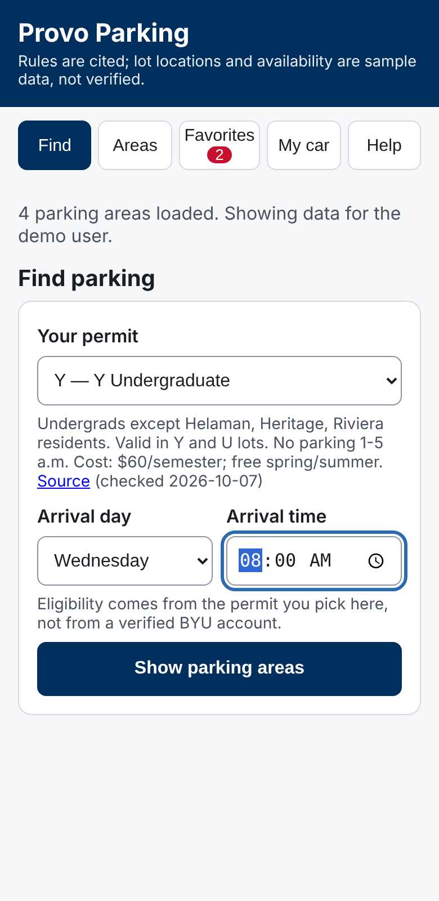 | 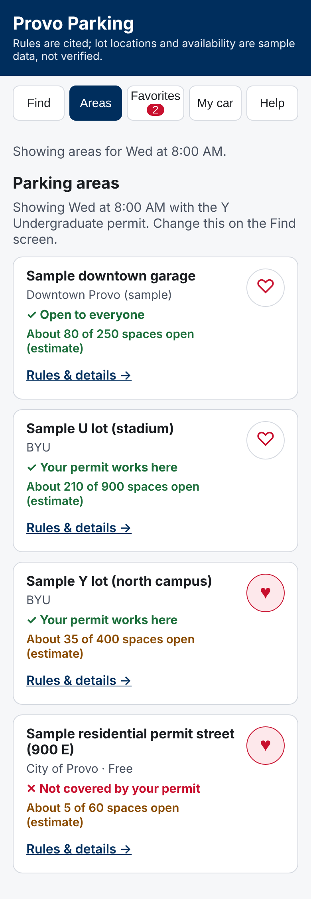 | 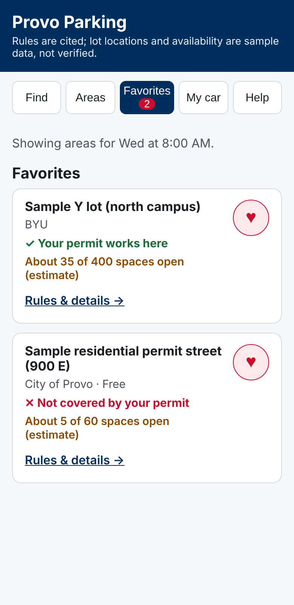 |

| 4. My car | 5. Help |
|---|---|
| 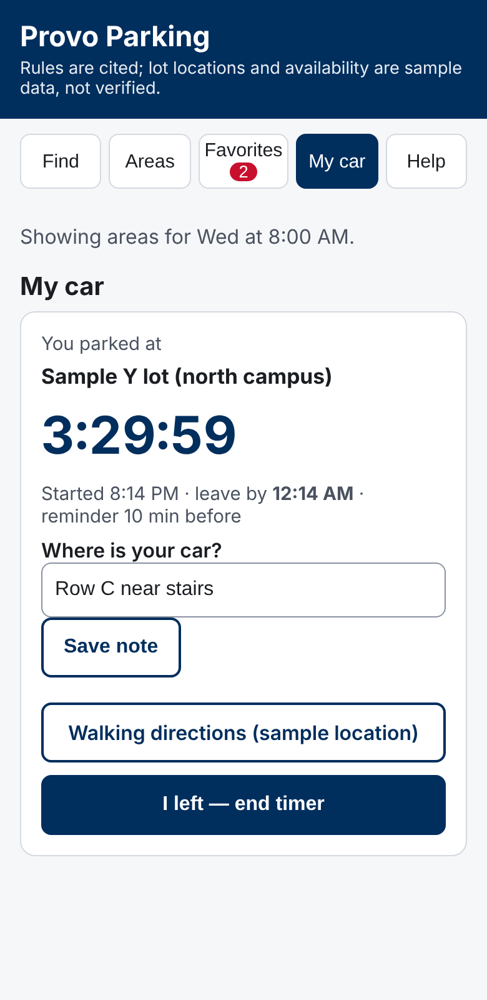 | 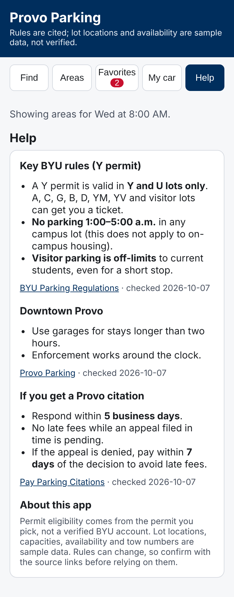 |

### Desktop (1280 px wide)
The layout is a single centered column, so on a desktop browser it looks like the phone view with more empty space around it.

**1. Find**

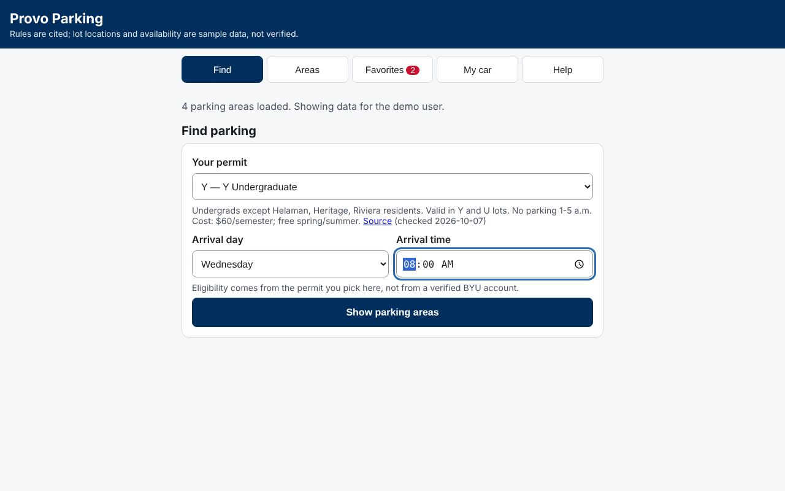

**2. Areas**

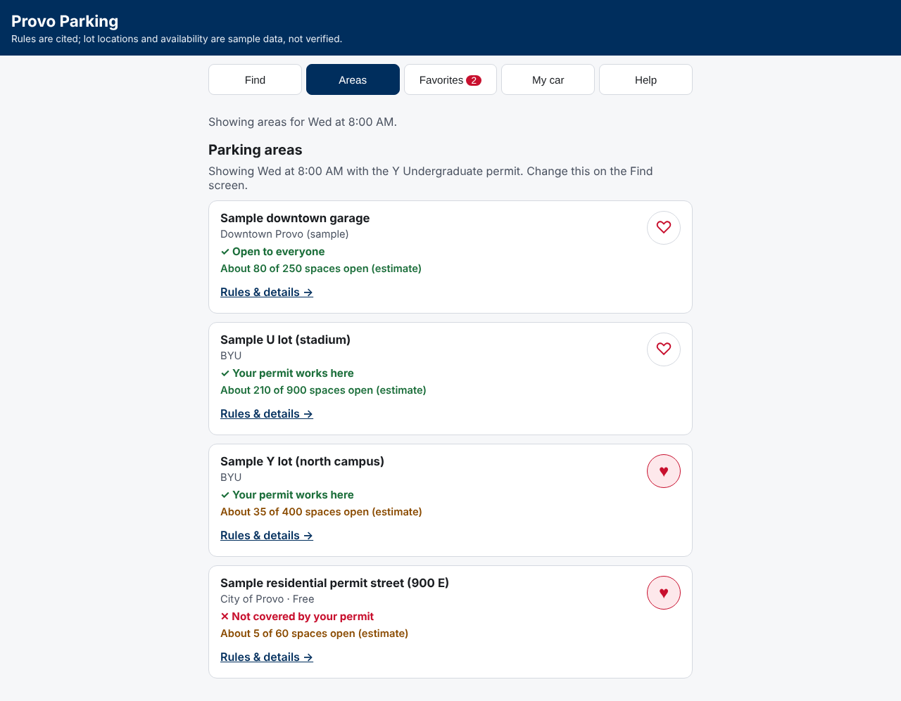

**3. Favorites**

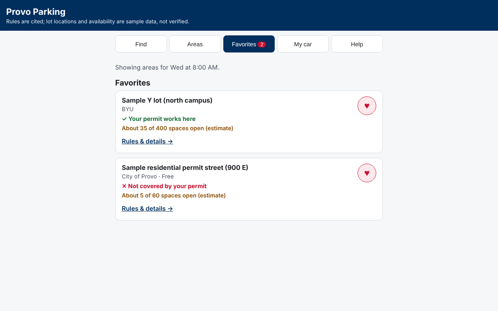

**4. My car**

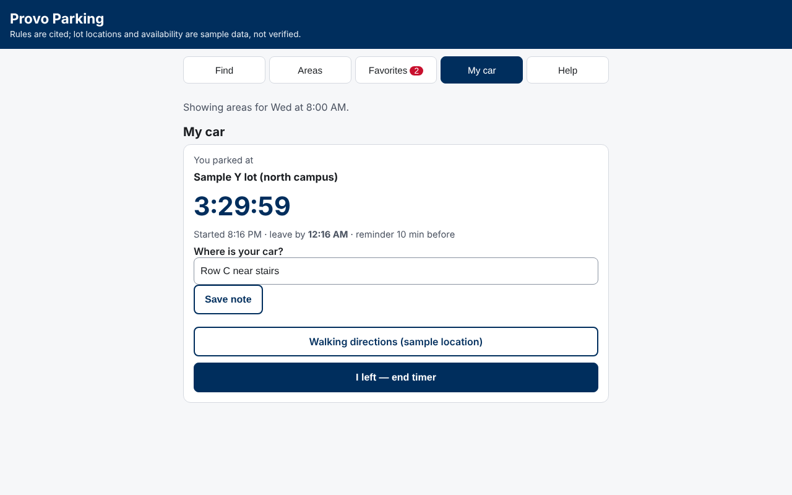

**5. Help**

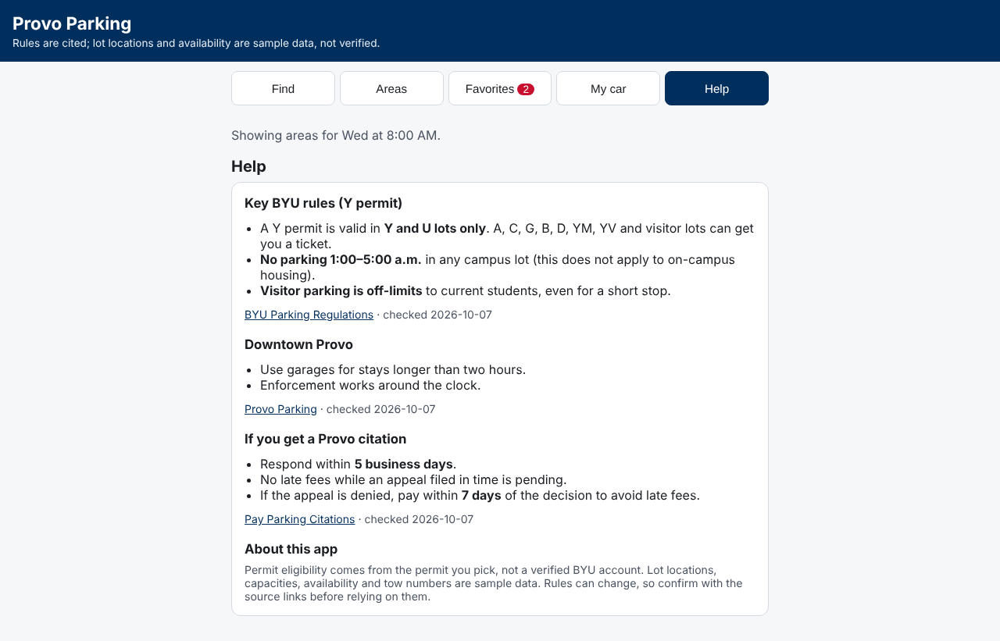

## ERD
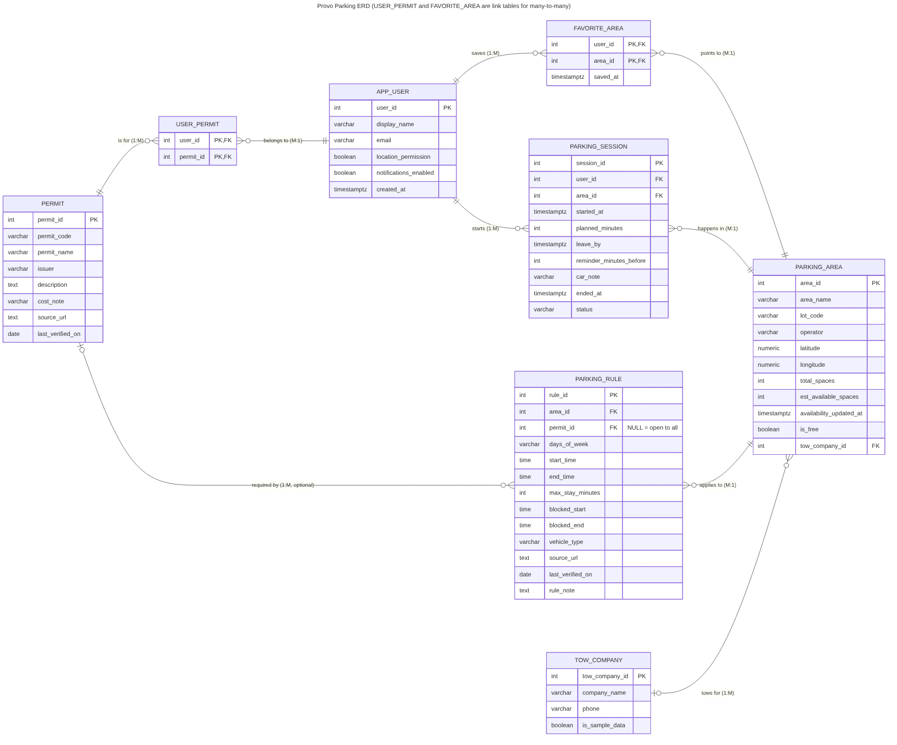

Source: [`docs/erd.mmd`](docs/erd.mmd) (Mermaid). Eight entities:

| Relationship | Cardinality |
|---|---|
| app_user ↔ permit, through the link table `user_permit` (one user can hold many permits; one permit type is held by many users) | many-to-many |
| app_user ↔ parking_area as favorites, through the link table `favorite_area` | many-to-many |
| app_user → parking_session | one-to-many |
| parking_area → parking_session | one-to-many |
| parking_area → parking_rule | one-to-many |
| permit → parking_rule (optional; no permit = open to all) | one-to-many |
| tow_company → parking_area | one-to-many |

## Tech Stack
| Layer | What we use |
|---|---|
| Frontend | Plain HTML, CSS, and JavaScript ES modules, no build step (`index.html`, `css/styles.css`, `js/`) |
| Backend / API | Supabase auto-generated REST API, called with `supabase-js` 2.45.4 |
| Database | Supabase PostgreSQL (`supabase/schema.sql`), with Row Level Security (`supabase/policies.sql`) |
| Hosting | GitHub Pages, deployed by GitHub Actions (`.github/workflows/pages.yml`) |
| Checks | Syntax check and unit tests on every pull request (`.github/workflows/ci.yml`, `npm test`) |

**Why this fits our team:** Supabase gives us a real PostgreSQL database and an API on a free tier without anyone running or deploying a server. Everyone can see the tables in Supabase's Table Editor and all the code in GitHub. Supabase does not host web pages, so the frontend is hosted free on GitHub Pages from this same repo.

**Keys:** the Supabase URL and anon key are never committed. Locally they go in `config.js`, which is in `.gitignore`. For the live site, GitHub Actions writes `config.js` from the repository secrets `SUPABASE_URL` and `SUPABASE_ANON_KEY`. The anon key is meant to be used in a browser; Row Level Security limits it to reading parking areas and managing the demo user's favorites.

## Project Structure
```
index.html        screens and tab bar
css/styles.css    styles
js/main.js        entry point
js/router.js      hash routes
js/state.js       shared state
js/pages/         one file per screen
js/data/          every Supabase call
js/domain/        eligibility rules (unit tested)
js/components/    shared HTML pieces
tests/            unit tests (npm test)
supabase/         schema, policies, dated change files
```
How to add a page, branch naming, pull requests and database changes: [docs/CONTRIBUTING.md](docs/CONTRIBUTING.md).

## How to Get It Running

### P2 behavioral requirement status

| Requirement | Status |
|---|---|
| Live permit choices load from Supabase | Complete — 11 options |
| Areas and lot details display database parking rules | Complete — checked with Y and residential permits and daytime/overnight arrivals |
| Public reference reads work while reference writes and personal data stay protected | Complete — browser-role SQL assertions pass |
| Phone/laptop layouts and Lighthouse Accessibility ≥90 | Complete for captured layouts and automated checks — Find, Areas and details scored 100/100 at both sizes; real-phone interaction review remains pending |
| Teammate review, merge to main and PO acceptance | Not complete — [PR #5](https://github.com/ParkerMorris11/ProvoParking/pull/5) |

Detailed checks, evidence and limits: [P2 verification](docs/p2-live-data-check.md). Lot locations, availability and tow contacts remain sample data.

Existing team database: if parking areas load but Find has no permit choices, see [P2 live-data diagnosis and verification](docs/p2-live-data-check.md). The reference-read migration was approved and applied to the team project on October 29, 2026; do not recreate the database or rerun the sample seed to fix this symptom.

### 1. Create the database (once per team)
1. Sign in at [supabase.com](https://supabase.com) and create a new project (free tier).
2. Open **SQL Editor**, paste all of [`supabase/schema.sql`](supabase/schema.sql), and click **Run**. This creates 8 tables with sample rows.
3. In a new query, paste [`supabase/policies.sql`](supabase/policies.sql) and click **Run**.
   - If you already ran an older `policies.sql` before the Find, Area details, and My car screens existed, run [`supabase/2026-10-14-screens-policies.sql`](supabase/2026-10-14-screens-policies.sql) instead. Without it those screens show a permissions error.
4. Check: **Table Editor** should list 8 tables, each with rows.
5. Go to **Project Settings > API** and copy the **Project URL** and the **anon / publishable key**.

### 2. Run it on your computer
1. Clone the repo: `git clone https://github.com/ParkerMorris11/ProvoParking.git` and `cd ProvoParking`.
2. Copy `config.example.js` to `config.js` and paste in your Project URL and anon key.
3. Start a local web server in the folder, for example `npm start` (Node) or `python3 -m http.server 8000`. Opening `index.html` directly as a file does not work, because the app uses JavaScript modules.
4. Open the address it prints (e.g. `http://localhost:8000`). You should see "4 parking areas loaded."

### 3. Live site (GitHub Pages)
1. In the GitHub repo, go to **Settings > Secrets and variables > Actions** and add two repository secrets: `SUPABASE_URL` and `SUPABASE_ANON_KEY`.
2. Go to **Settings > Pages** and set **Source** to **GitHub Actions**.
3. Push to `main` (or run the "Deploy to GitHub Pages" workflow from the **Actions** tab). The live URL appears in the workflow run.

## Verifying the Vertical Slice
The working button is the **heart (Save to favorites)** on each parking area.

1. Open the app and note the number on the **Favorites** tab (it was 2 with the original sample data; it changes as people test).
2. Tap an empty heart, for example on **Sample downtown garage**. The heart fills, the message says "Saved Sample downtown garage to favorites," and the count goes up by 1.
   - Behind the scenes, `js/data/favorites.js` sends an insert request to Supabase, a row is added to `favorite_area`, and Supabase returns the saved row, which the page then displays.
3. **Refresh the page.** The garage's heart is still filled and the count is unchanged.
4. Open the **Favorites** tab: the garage is listed.
5. Optional: in Supabase **Table Editor > favorite_area**, there is a new row with `user_id = 1` and the garage's `area_id`.
6. Tap the heart again to remove it; after a refresh it stays removed.

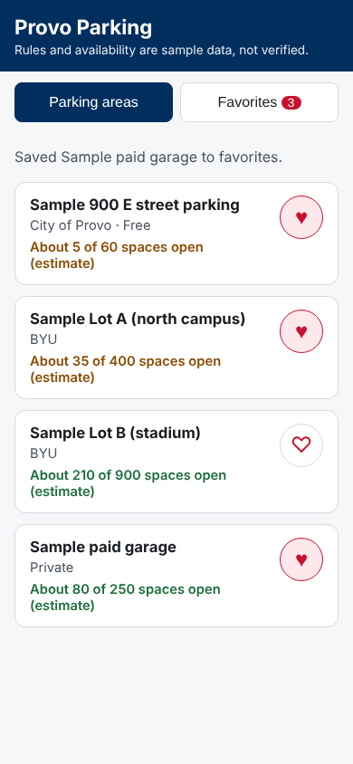

## Verifying the Other Screens
1. **Find:** choose permit **Y**, any day, **8:00 AM**, press **Show parking areas**. The Y lot, U lot, and garage show a green ✓; the 900 E residential street shows a red ✕ "Not covered by your permit".
2. Go back to **Find**, set the time to **3:00 AM**, and submit. The campus lots now show ✕ "No parking 1:00 AM–5:00 AM".
3. **Area details:** tap *Rules & details* on any area. You should see the rules, a source link with a checked date, and the tow contact (a sample number).
4. **My car:** tap *Park here — start timer* on an area (or use the My car tab), pick a duration, and press **Start parking timer**. A countdown appears. Refresh: it is still running. Check Supabase **Table Editor > parking_session** for the new row (`status = active`).
5. Press **I left — end timer**. The row's `status` becomes `ended` (or `expired` if you were over time).

Run `npm test` for the eligibility unit tests (Node 20+, nothing to install).

Testing note: the screen logic was checked in a headless browser against an in-memory stand-in for Supabase seeded with the sample rows. It has **not** yet been run against the team's real Supabase project, so do the steps above once after running the policies.
