# Provo Parking

Provo Parking helps BYU drivers see where their permit lets them park right now, read the rules in plain language, time their stay, and save favorite lots. Mapped parking facilities across Provo city limits is shown alongside campus lots as unverified city/OSM records.

## Sprint 2 status (November 5, 2026)

| Area | What is live on `main` | Details |
|---|---|---|
| Accounts | One-screen sign-up, *Continue with Google*, optional permit step. Email confirmation is off, so a new account can use the app right away. | [Accounts and sign-in](#accounts-and-sign-in) |
| BYU lots | 102 verified BYU lot sections (ordinary A, G, Y and U rules) on the map and list, filtered by your permit and Provo time | [Verified sections](docs/verified-byu-sections.md) |
| Provo city lots | 28 Provo City GIS public facilities plus OpenStreetMap lots/garages/on-street tags across Provo city limits, shown as unverified records with directions (never used for permits or the My car timer) | [Map and data sources](#map-and-data-sources) |
| Favorites | Saved lots with **Get Directions** | [Screens](#screens) |
| Help | BYU permit table (who it is for, where it is valid), how to read results, Provo and citation rules, all with source links | [Screens](#screens) |
| OKRs | Admin dashboard (`admin.html`) reports all four Key Results from database aggregates; KR 2b visit timing is recorded | [Admin OKR dashboard](docs/admin-okr.md), [visit metrics](docs/visit-metrics-handoff.md) |
| Still to do | AI workflow automation and its Level 1 DFD (Sprint 3), Lighthouse re-check of the new map and Help content | Trello Product Backlog |

P7 database persistence for parking sessions: [parking session persistence](docs/parking-session-persistence.md).

IS 401-001, Fall 2026, Team 007: Parker Morris, Liam Tanaka, Spencer Warren, James Richardson.

Live app: https://parkermorris11.github.io/ProvoParking/ (works once the Pages setup in step 3 below is done)

P5/P6 local parking flow: [Parking timer setup](parking-setup.html) → review → **Confirm & Start Timer** → [Parking timer](parking-timer.html). Serve the repository locally; no Supabase configuration is needed. The session is saved in this browser so you can return through **View parking timer** or refresh without resetting its timestamps. See [the P5 contract](docs/parking-timer-setup.md) and [P6 timer contract and sample states](docs/active-parking-timer.md). The existing Supabase My car timer remains available separately; these sessions do not sync with it or across devices.

> 102 BYU lot sections use official map locations and sourced permit/hour rules checked November 4, 2026 ([sections](docs/verified-byu-sections.md); the first four lots are in [verified lots](docs/verified-byu-lots.md)). Capacity, live availability and tow contacts are unknown. Old sample records remain only for history.

## App Summary
Students who drive to BYU often circle lots that are full or that their permit doesn't cover, which makes them late and leads to parking tickets. Our persona, Emma Carter, is a BYU junior who commutes for 8 a.m. classes and has received three tickets this year. Provo Parking lets a driver choose their permit and planned arrival time, then shows which nearby parking areas they are allowed to use and how full each one is likely to be. Each area explains its rules in plain language, including time limits and when restrictions change. After parking, the user can start a parking timer, see where they left the car, and save favorite areas for future trips. This version has a sign-up/log-in screen and five app screens (see below). Each person has their own account; their permits, favorites and parking timers are stored in a real database so they survive a refresh and follow them to another device. Eligibility is based on the permit the user selects, not on a verified BYU account.

## Screens
| # | Screen | What it does | Data it uses |
|---|---|---|---|
| 0 | **Sign up / Log in** | Create an account (email + password, then name and permits) or log in; *Keep me signed in*, *Forgot password*, *Continue as guest* | Supabase Auth, `app_user`, `user_permit`, `permit` |
| 1 | **Find** | Pick your permit, arrival day, and arrival time (starts on your account's permit) | `permit`, `user_permit` |
| 2 | **Areas** | Only verified lots allowed for your selected permit and parking time; cards, map and nearby suggestions share the same filter. Defaults to current Provo time with automatic updates; explicit planned arrivals remain available. | `parking_area`, `parking_rule`, `favorite_area` |
| 3 | **Area details** (tap *Rules & details*) | Plain-language rules grouped by schedule, with source link and last-verified date, tow contact, walking-directions link, and a *Park here* button | `parking_rule`, `permit`, `tow_company` |
| 4 | **Favorites** | Areas you saved with the heart, each with a **Get Directions** button that opens driving directions in Google Maps | `favorite_area` |
| 5 | **My car** | Start a parking timer, see a countdown and a reminder banner, save where the car is, end the timer | `parking_session` |
| + | **Help** (extra tab) | BYU permit table (who each permit is for and which lots it is valid in, checked against the July 23, 2026 regulations), how to read results, Provo rules, what to do about a citation, with source links; static | none |

**Favorite directions:** Get Directions opens Google Maps in a new tab (or its installed mobile app), with driving directions to that saved lot ready for the user to choose Start. Google Maps uses the device's current location when available; otherwise, it asks for a starting point. This uses the existing [Google Maps URLs integration](https://developers.google.com/maps/documentation/urls/get-started), so no Google API key or new setup is needed. Coordinates identify lot centers, not entrances; sample locations are labeled, and lots without valid coordinates show a directions-unavailable message.

Eligibility rule: an area is usable if a rule that applies on the chosen day and time is open to everyone or lists your permit, and the time is not inside that rule's no-parking window (for example BYU's 1-5 a.m.). A valid permit does not mean a space is open; availability is always labeled an estimate. Reminders only show while the page is open (no push notifications), and walking-directions links point at sample lot locations.

Schedule behavior: rule start/end times include both endpoints, including schedules that cross midnight. Blocked hours include the start and exclude the end (so a 1–5 a.m. ban ends at 5:00). Days refer to the selected calendar day, including the after-midnight part of an overnight schedule; an overnight Friday-to-Saturday rule must list both days. Unreadable rule schedules cannot grant permission; if no valid rule covers the selection, the result is unknown. The check covers the selected arrival minute, not the driver's entire planned stay. The four verified BYU lots use normal fall/winter weekly schedules. Events, posted signs, finals, holidays and academic breaks can override them; this day/time form does not model calendar exceptions. See [verified lots](docs/verified-byu-lots.md).

## Screenshots
### Phone (390 px wide)
Screenshots of the five tabs. They were captured from the real page code, but with the sample rows from `supabase/schema.sql` served by a local stand-in for Supabase, not from the team's live database. The countdown and "updated" times change when you run it yourself.

| 1. Find | 2. Areas | 3. Favorites |
|---|---|---|
| 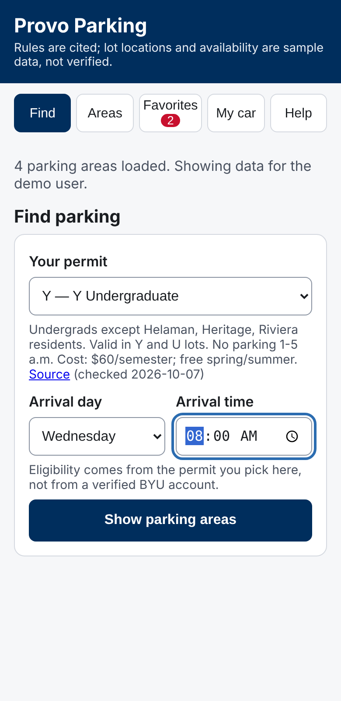 | 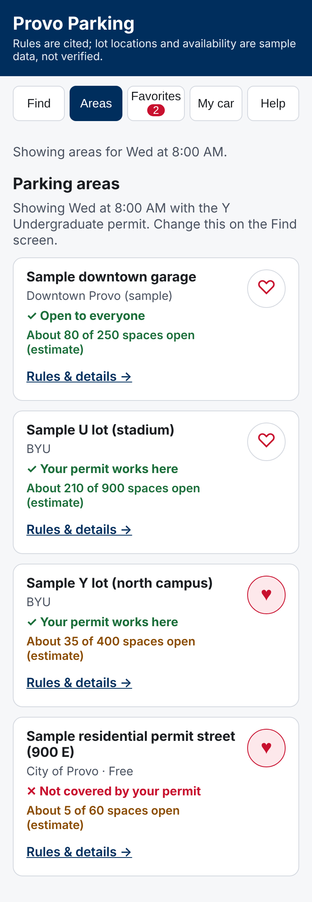 | 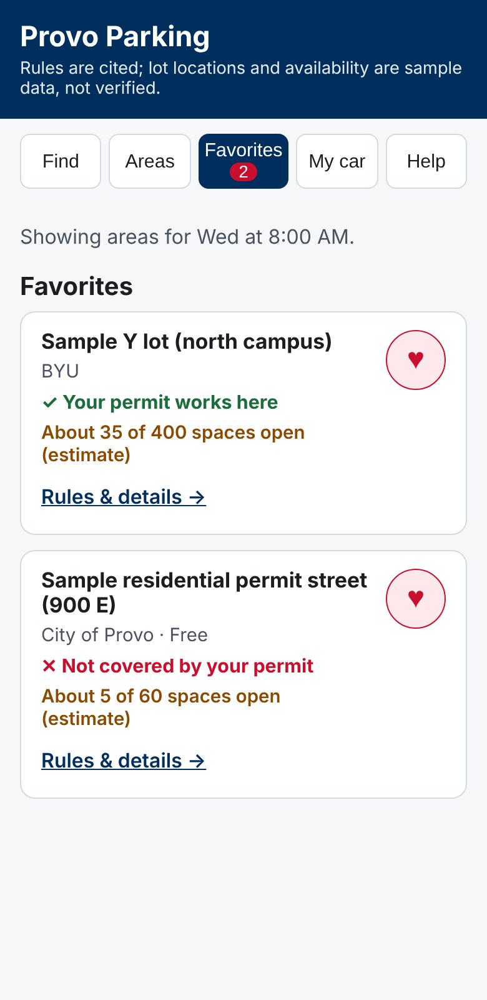 |

| 4. My car | 5. Help |
|---|---|
| 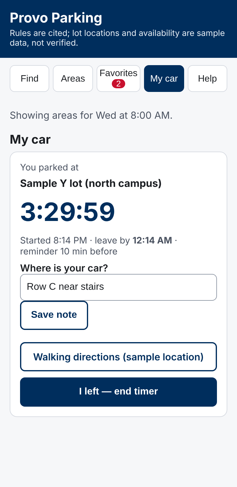 | 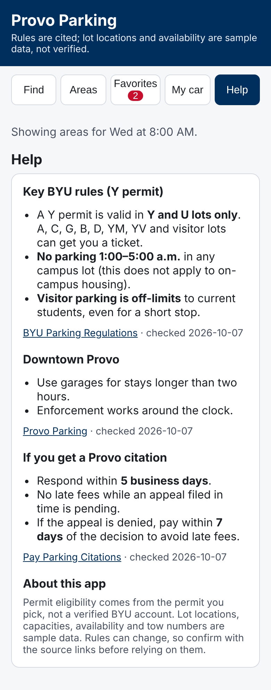 |

### Desktop (1280 px wide)
The layout is a single centered column, so on a desktop browser it looks like the phone view with more empty space around it.

**1. Find**

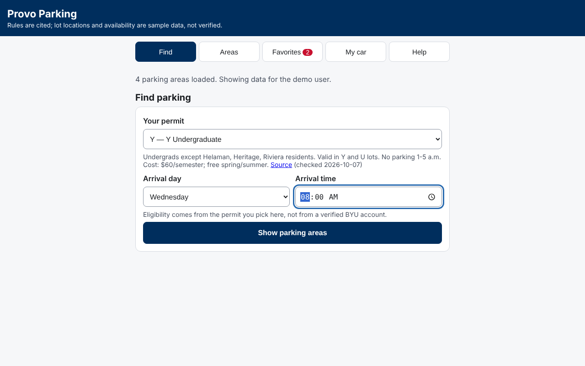

**2. Areas**

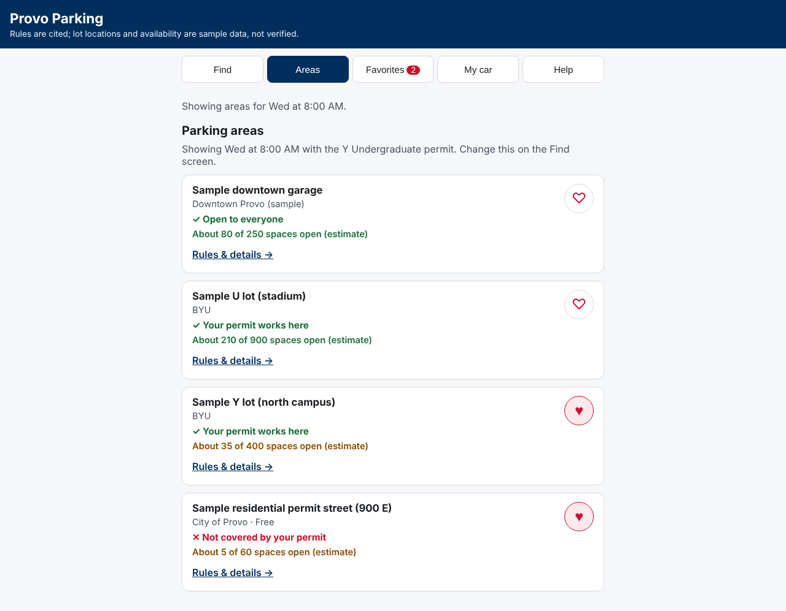

**3. Favorites**

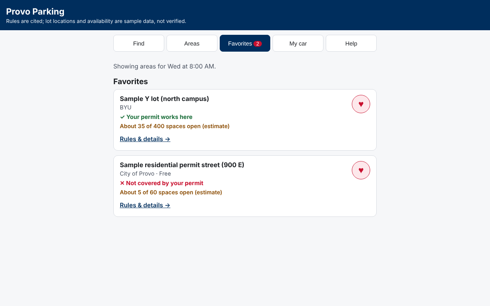

**4. My car**

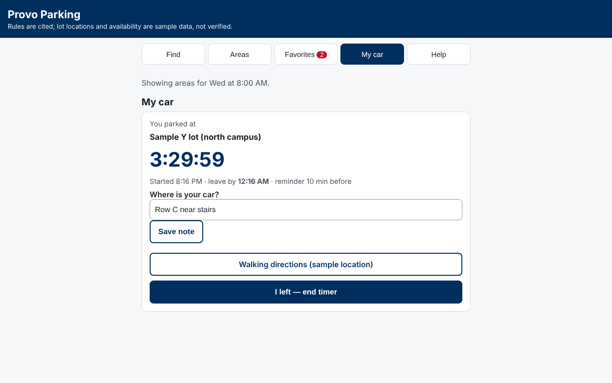

**5. Help**

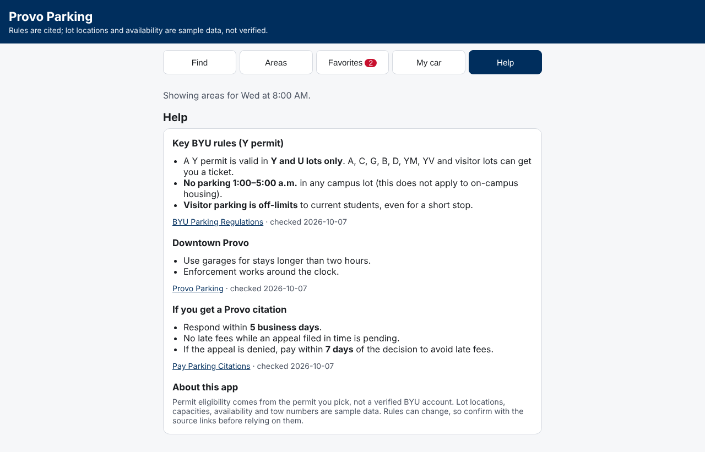


## Accounts and sign-in

| Situation | What the person sees |
|---|---|
| First visit on a device | **Create your account**: *Continue with Google*, or email + password. *Create account* creates the account immediately, so a taken email or rejected password is shown on that same screen. Then an optional *Which permit do you have?* search over the `permit` table (type "Y", "grad", "Wymount"), or *skip* |
| *Continue with Google* | Google's own sign-in page, then straight back signed in; no new password and no confirmation email. A first Google sign-in gets the same optional permit step. The button only appears when Google is turned on in Supabase |
| Comes back on the same device | Straight into the app, still signed in. supabase-js keeps the session in `localStorage` and renews it automatically |
| *Keep me signed in* unchecked at log-in | The session is kept in `sessionStorage` and ends when the browser closes |
| Logged out, or a device that signed in before | **Welcome back** (email, password, *Forgot password*) |
| A different computer | No session there, so **Create your account** / **Log in** |
| *Continue as guest* | Can browse areas and rules; tapping a heart or starting a timer asks them to create an account |

**How it is wired**

1. `js/pages/auth.js` validates the form as you type (`js/domain/account.js`) and calls `js/data/auth.js`: Supabase Auth `signUp` (email) or `signInWithOAuth` (Google). The permit step saves `user_permit` rows for the signed-in user.
2. In the database, the `on_auth_user_created` trigger (`supabase/migrations/20261102040636_account_sign_in.sql`, updated by `20261104202009_google_sign_in_names.sql` to use a Google user's name) creates the `app_user` row (linked by `app_user.auth_id`). Bad metadata never blocks a sign-up.
3. The browser loads the profile (`app_user` + `user_permit`), presets Find to the account's permit, and loads only that account's `favorite_area` and `parking_session` rows. `js/data/favorites.js` and `js/data/sessions.js` save with the signed-in `user_id`; row security rejects anything else.
4. Errors from Supabase (wrong password, email already used, rate limits, no internet) are shown in plain language next to the right field.

The migration also removes the old shared *demo user 1* browser policies, so visitors can no longer write data. Demo rows are kept.

**Tests:** `tests/account.test.js` (form checks, error messages, permit search, *Keep me signed in*) and `tests/account-sign-in-db.test.js` (real PostgreSQL: trigger, permits, per-user row security for profiles, favorites and sessions, visitor access, and the team's `tests-reference-reads.sql`). The two database suites share one disposable database, so `npm test` runs test files one at a time.

## ERD


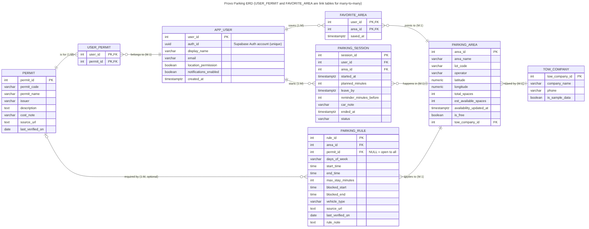

Source: [`docs/erd.mmd`](docs/erd.mmd) (Mermaid). Eight entities:

| Relationship | Cardinality |
|---|---|
| app_user ↔ permit, through the link table `user_permit` (one user can hold many permits; one permit type is held by many users) | many-to-many |
| app_user ↔ parking_area as favorites, through the link table `favorite_area` | many-to-many |
| app_user → parking_session | one-to-many |
| parking_area → parking_session | one-to-many |
| parking_area → parking_rule | one-to-many |
| permit → parking_rule (optional; no permit = open to all) | one-to-many |
| tow_company → parking_area | one-to-many |


Sprint 2 review evidence: [Parker’s card verification and remaining checks](docs/sprint-2-parker-review.md).

## System architecture (Sprint 1 review)

The customer app is live on GitHub Pages and uses Supabase. The AWS admin portal and AI workflow below are **planned**, not deployed. The FigJam contains the team's visual copy.

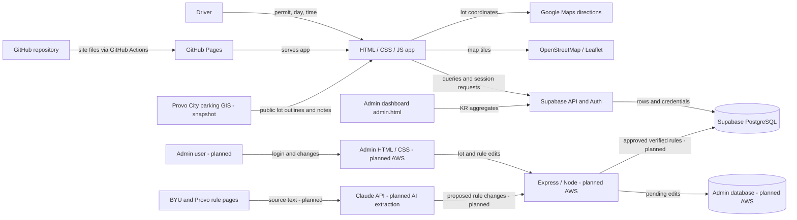

The planned AI workflow requires human review before rule changes are published.

## Data flow diagrams (Sprint 2 review)

Both diagrams use logical names (what happens to the data), not product names. Processes 5.0 and 6.0 are the AI workflow automation: the app reads parking rule pages, an AI service extracts proposed rule changes, and a team admin approves them before they reach the parking rules. That automation is **planned for Sprint 3**; everything else is live today.

**Level 0 (context diagram):** the whole app as one process, every external entity, and the data flowing in and out. No data stores.

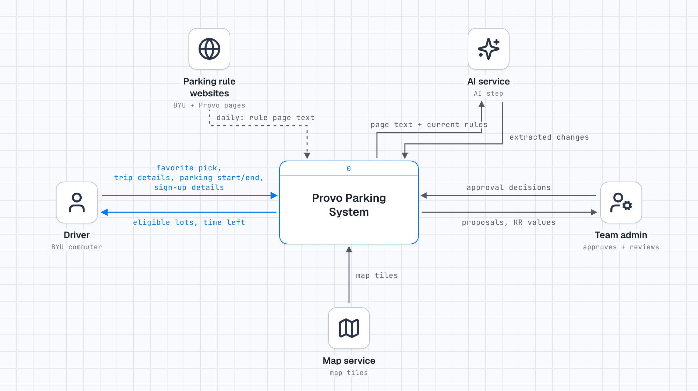

**Level 1 (logical):** the same external entities and outside flows, opened into numbered processes and data stores.

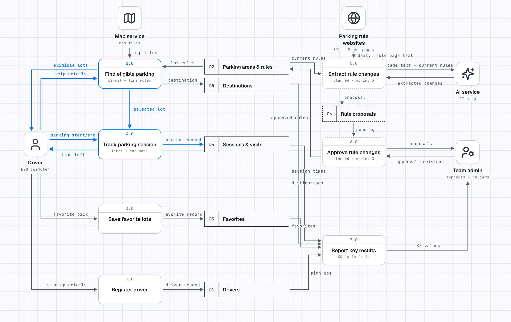

| Data store | Tables today |
|---|---|
| D1 Drivers | `app_user`, `user_permit` |
| D2 Parking areas & rules | `parking_area`, `parking_rule`, `permit` |
| D3 Favorites | `favorite_area` |
| D4 Parking sessions & visits | `parking_session`, `app_visit` |
| D5 Destinations | `destination` |
| D6 Rule change proposals | `rule_change_proposal` (planned, Sprint 3) |

Editable sources: `docs/dfd/*.svg`.

## Tech Stack
| Layer | What we use |
|---|---|
| Frontend | Plain HTML, CSS, and JavaScript ES modules, no build step (`index.html`, `css/styles.css`, `js/`) |
| Backend / API | Supabase auto-generated REST API, called with `supabase-js` 2.45.4 |
| Database | Supabase PostgreSQL (`supabase/schema.sql`), with Row Level Security (`supabase/policies.sql`) |
| Hosting | GitHub Pages, deployed by GitHub Actions (`.github/workflows/pages.yml`) |
| Checks | Syntax check and unit tests on every pull request (`.github/workflows/ci.yml`, `npm test`) |

**Why this fits our team:** Supabase gives us a real PostgreSQL database and an API on a free tier without anyone running or deploying a server. Everyone can see the tables in Supabase's Table Editor and all the code in GitHub. Supabase does not host web pages, so the frontend is hosted free on GitHub Pages from this same repo.

**Keys:** the Supabase URL and anon key are never committed. Locally they go in `config.js`, which is in `.gitignore`. For the live site, GitHub Actions writes `config.js` from the repository secrets `SUPABASE_URL` and `SUPABASE_ANON_KEY`. The anon key is meant to be used in a browser; Row Level Security lets visitors read only the public reference data (areas, permits, rules, tow companies); a signed-in user can also read and change only their own profile, permits, favorites and My car sessions.

## Project Structure
```
index.html        screens and tab bar
css/styles.css    styles
js/main.js        entry point
js/router.js      hash routes
js/state.js       shared state
js/pages/         one file per screen
js/data/          every Supabase call
js/domain/        eligibility rules (unit tested)
js/components/    shared HTML pieces
tests/            unit tests (npm test)
supabase/         schema, policies, dated change files
```
How to add a page, branch naming, pull requests and database changes: [docs/CONTRIBUTING.md](docs/CONTRIBUTING.md).

## Parker — Sprint 1 status (November 2, 2026; accepted November 4)

| Card / behavioral requirement | Status |
|---|---|
| P2: load live permit choices and display database rules | Complete — merged and deployed; awaiting PO acceptance |
| P4: choose permit/time → see rules → save a favorite → refresh | Complete — verified on the published site against the current sample areas; awaiting PO acceptance |
| P5: handle permit, day and restricted-hour changes | Complete — original logic tests plus real migration-backed permit/hour boundary checks |
| P5: confirm allowed/blocked results for verified lots | Implemented for 59Y, 30G, 14A and 18U; production checks and PO review are tracked on the card |

[Verification record and limits](docs/sprint-1-parker-verification.md). P21 sign-in remains delegated/paused and is not part of this Sprint 1 completion check. No course goals, estimates, or Definition of Done were changed.

## How to Get It Running

### P2 behavioral requirement status

| Requirement | Status |
|---|---|
| Live permit choices load from Supabase | Complete — 11 options |
| Areas and lot details display database parking rules | Complete — checked with Y and residential permits and daytime/overnight arrivals |
| Public reference reads work while reference writes and personal data stay protected | Complete — browser-role SQL assertions pass |
| Phone/laptop layouts and Lighthouse Accessibility ≥90 | Complete for captured layouts and automated checks — Find, Areas and details scored 100/100 at both sizes; real-phone interaction review remains pending |
| Review and merge to main | Complete — [PR #5](https://github.com/ParkerMorris11/ProvoParking/pull/5) merged and deployed |
| PO acceptance | Complete — accepted in Sprint 1 Review (November 4, 2026) |

Detailed checks, evidence and limits: [P2 verification](docs/p2-live-data-check.md). Lot locations, availability and tow contacts remain sample data.

Existing team database: if parking areas load but Find has no permit choices, see [P2 live-data diagnosis and verification](docs/p2-live-data-check.md). The reference-read migration was approved and applied to the team project on October 29, 2026; do not recreate the database or rerun the sample seed to fix this symptom.

### 1. Create the database (once per team)
1. Sign in at [supabase.com](https://supabase.com) and create a new project (free tier).
2. Open **SQL Editor**, paste all of [`supabase/schema.sql`](supabase/schema.sql), and click **Run**. This creates 8 tables with sample rows.
3. In a new query, paste [`supabase/policies.sql`](supabase/policies.sql) and click **Run**.
   - Then run every file in [`supabase/migrations/`](supabase/migrations/) in name order. The last one, [`20261102040636_account_sign_in.sql`](supabase/migrations/20261102040636_account_sign_in.sql), turns on accounts.
   - Email confirmation remains enabled. Finish the email sender and production Site URL / redirect configuration with the teammate responsible for sign-in before testing public sign-ups. The UI supports confirmation links; do not disable confirmation as an automatic merge step.
   - If you already ran an older `policies.sql` before the Find, Area details, and My car screens existed, run [`supabase/2026-10-14-screens-policies.sql`](supabase/2026-10-14-screens-policies.sql) instead. Without it those screens show a permissions error.
4. Check: **Table Editor** should list 8 tables, each with rows.
5. Go to **Project Settings > API** and copy the **Project URL** and the **anon / publishable key**.

### 2. Run it on your computer
1. Clone the repo: `git clone https://github.com/ParkerMorris11/ProvoParking.git` and `cd ProvoParking`.
2. Copy `config.example.js` to `config.js` and paste in your Project URL and anon key.
3. Start a local web server in the folder, for example `npm start` (Node) or `python3 -m http.server 8000`. Opening `index.html` directly as a file does not work, because the app uses JavaScript modules.
4. Open the address it prints (e.g. `http://localhost:8000`). You should see "4 parking areas loaded."

### 3. Live site (GitHub Pages)
1. In the GitHub repo, go to **Settings > Secrets and variables > Actions** and add two repository secrets: `SUPABASE_URL` and `SUPABASE_ANON_KEY`.
2. Go to **Settings > Pages** and set **Source** to **GitHub Actions**.
3. Push to `main` (or run the "Deploy to GitHub Pages" workflow from the **Actions** tab). The live URL appears in the workflow run.

## Verifying the Vertical Slice
The working button is the **heart (Save to favorites)** on each parking area.

1. Open the app and create an account (or log in). The **Favorites** tab starts at 0 for a new account.
2. Tap an empty heart, for example on **Sample downtown garage**. The heart fills, the message says "Saved Sample downtown garage to favorites," and the count goes up by 1.
   - Behind the scenes, `js/data/favorites.js` sends an insert request to Supabase, a row is added to `favorite_area`, and Supabase returns the saved row, which the page then displays.
3. **Refresh the page.** The garage's heart is still filled and the count is unchanged.
4. Open the **Favorites** tab: the garage is listed.
5. Optional: in Supabase **Table Editor > favorite_area**, there is a new row with your `user_id` (find it in **app_user** by your email) and the garage's `area_id`.
6. Tap the heart again to remove it; after a refresh it stays removed.
7. Log out and create a second account: its favorites start empty, because each account only sees its own.

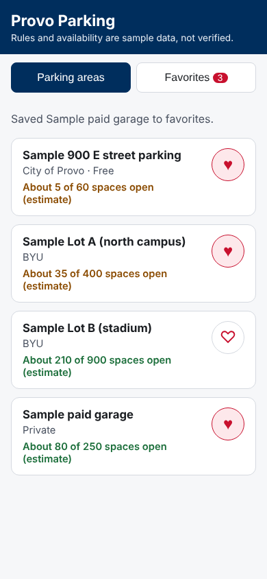

## Verifying the Other Screens
1. **Find:** choose permit **Y**, any day, **8:00 AM**, press **Show parking areas**. The Y lot, U lot, and garage show a green ✓; the 900 E residential street shows a red ✕ "Not covered by your permit".
2. Go back to **Find**, set the time to **3:00 AM**, and submit. The campus lots now show ✕ "No parking 1:00 AM–5:00 AM".
3. **Area details:** tap *Rules & details* on any area. You should see the rules, a source link with a checked date, and the tow contact (a sample number).
4. **My car:** tap *Park here — start timer* on an area (or use the My car tab), pick a duration, and press **Start parking timer**. A countdown appears. Refresh: it is still running. Check Supabase **Table Editor > parking_session** for the new row (`status = active`).
5. Press **I left — end timer**. The row's `status` becomes `ended` (or `expired` if you were over time).

Run `npm test` for the eligibility unit tests (Node 20+, nothing to install).

Testing note: the screen logic was checked in a headless browser against an in-memory stand-in for Supabase seeded with the sample rows. It has **not** yet been run against the team's real Supabase project, so do the steps above once after running the policies.

### Map integration (PR #11)

The Areas map displays a BYU boundary snapshot without sample location circles, alongside a separate list of database areas. A subdued base map and labeled permit-color legend help distinguish the boundaries. Boundary categories do not indicate live availability or permit eligibility. See [map integration and verification](docs/map-integration.md) for data limitations and testing. The team approved integration with merge commits to retain contributor history; see [integration verification](docs/integration-2026-11-01.md).

### Map and data sources

| Layer | Source | Checked | What it means |
|---|---|---|---|
| BYU lot sections (colored by category) | [BYU campus parking map](https://map.byu.edu/?layer=parking) and [BYU Parking Regulations](https://security.byu.edu/parking-regulations) | Nov 4, 2026 | Only sections whose listed rules match your permit and time are drawn |
| Provo lots and garages (dashed purple) | Provo City GIS layer [`Provo_Parking_Facilities`](https://services2.arcgis.com/u1JcjHKiYxDeQU3C/arcgis/rest/services/Provo_Parking_Facilities/FeatureServer/0), public facilities only; [Provo Parking](https://www.provo.gov/273/Parking); plus [OpenStreetMap](https://www.openstreetmap.org) `amenity=parking` inside OSM relation 198903 (Provo) | Nov 6, 2026 (city GIS records edited 2018–2023; OSM snapshot the same day) | Name, type, recorded spaces, hours and notes as the source recorded them. Not verified rules and never used for permit matching or the My car timer; every popup says to check signs |
| Base map | OpenStreetMap via Leaflet | | Background only |

The city snapshot is `data/provo-city-parking.json` (outlines simplified to about 10 m). Rebuild with `python3 scripts/build-city-parking.py` after refreshing `/tmp/provo-osm-parking-geom.json`. Turn the layer on or off with **Show Provo lots**, jump downtown with **Downtown**, fit the citywide layer with **Provo**, or open the list under the map for a keyboard- and screen-reader-friendly version with **Show on map**. Code: `js/pages/city-layer.js`, `js/domain/city-parking.js`, tests in `tests/city-parking.test.js`. City GIS still covers named downtown and civic public facilities. OSM adds lots across the city limits after dropping BYU/MTC campus features and explicitly restricted records. OpenStreetMap access that the snapshot cannot establish is labeled unknown. Residential permit zones and most signed on-street time limits are still missing.

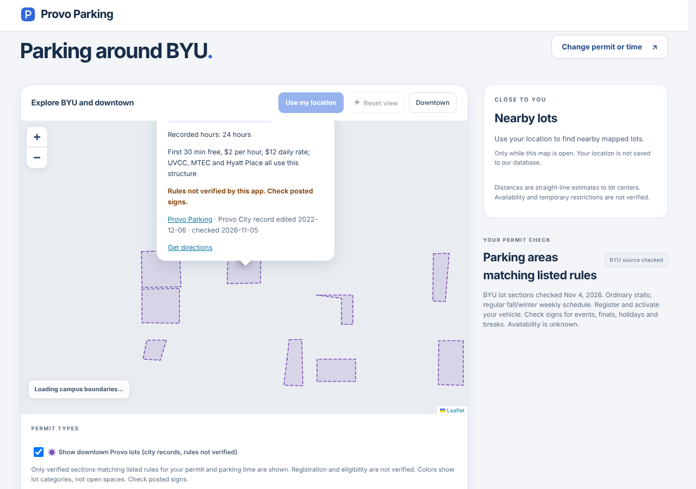

### Nearby lots with your location

On Areas, click **Use my location** and allow location access. The blue dot and nearest mapped lots update as you move; use **Stop tracking** to turn it off. Tracking also pauses when you leave the map or hide the tab. Location is not saved to our database. Nearby distances are estimates and do not verify open spaces or permission to park. See [location behavior and testing](docs/live-location.md).

### Supabase settings for smooth sign-in (project owner)
1. **Authentication > Sign In / Providers:** turn **Confirm email** off, so an email sign-up can use the app immediately (the free email service also sends only 2 emails per hour).
2. **Authentication > URL Configuration:** Site URL `https://parkermorris11.github.io/ProvoParking/`; Redirect URLs `https://parkermorris11.github.io/ProvoParking/**` and `http://localhost:8000/**`.
3. **Google:** in [Google Cloud Console](https://console.cloud.google.com/), create an OAuth client (type *Web application*) with the authorized redirect URI `https://rikekjksneoymybnehpo.supabase.co/auth/v1/callback`, and set the consent screen to *In production*. Paste its Client ID and Client secret into **Authentication > Sign In / Providers > Google** and enable it. The app shows *Continue with Google* automatically once this is on.
