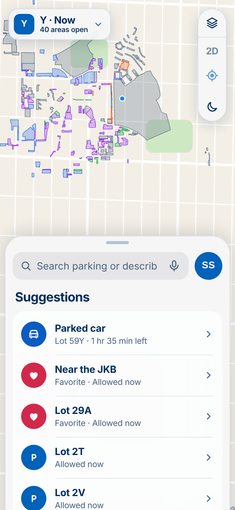
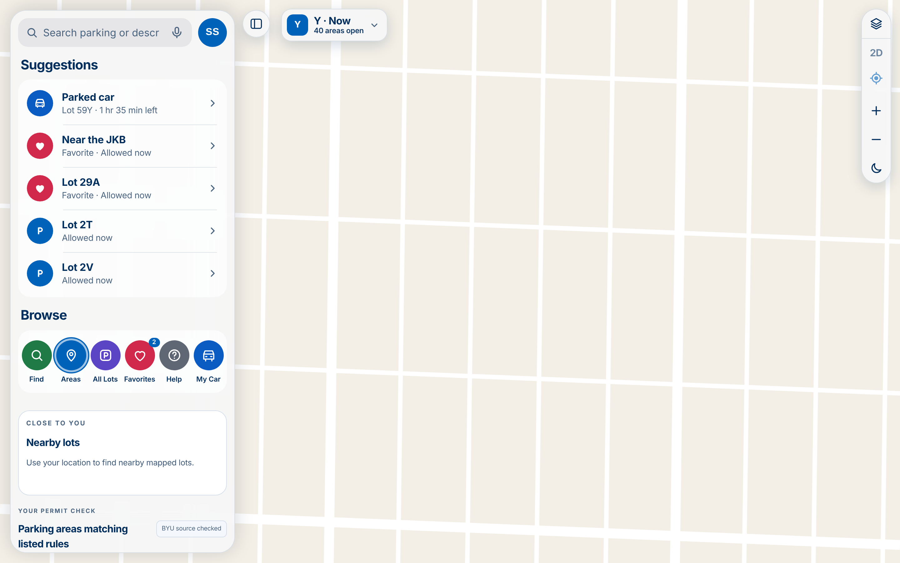
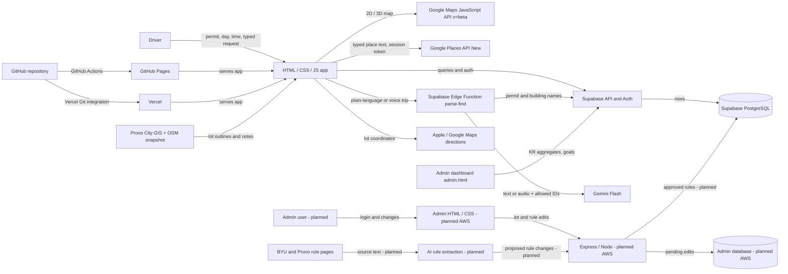
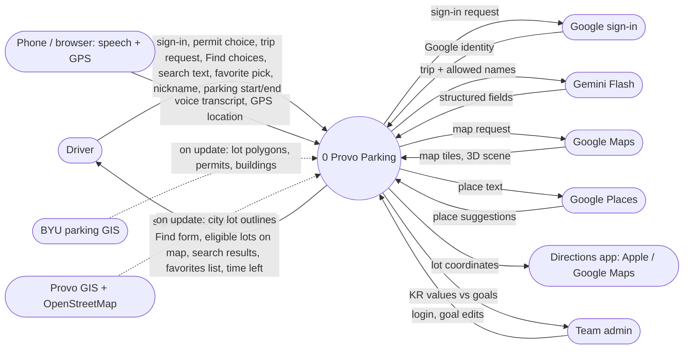
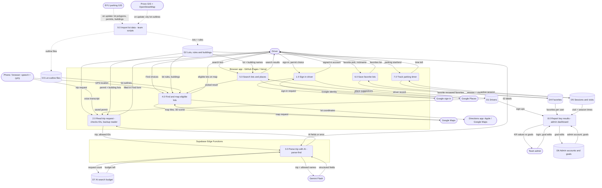

[](https://vitejs.dev/)
[](https://react.dev/)
[](https://developers.google.com/maps)
[](https://ai.google.dev/)
[](https://tailwindcss.com/)


# Provo Parking

Provo Parking helps BYU drivers see where their permit lets them park right now, read the rules in plain language, time their stay, and save favorite lots. Provo city lots are shown alongside campus lots as unverified city/OpenStreetMap records.

IS 401-001, Fall 2026, Team 007: Parker Morris, Liam Tanaka, Spencer Warren, James Richardson.

**Live app:** https://provo-parking.vercel.app/ (also on GitHub Pages: https://parkermorris11.github.io/ProvoParking/)

Scan to open the live app on your phone ([PNG](assets/provo-parking-qr.png) for slides or printing, [SVG](assets/provo-parking-qr.svg) for any size, [card with the address printed below](assets/provo-parking-qr-card.png) for phones):


## Contents

- [What the app does](#what-the-app-does)
- [Screens](#screens)
- [System architecture](#system-architecture)
- [Data flow diagrams](#data-flow-diagrams)
- [Data model (ERD)](#data-model-erd)
- [Run it locally](#run-it-locally)
- [Configuration and keys](#configuration-and-keys)
- [Database setup and migrations](#database-setup-and-migrations)
- [Deploy](#deploy)
- [Tests and checks](#tests-and-checks)
- [Project structure](#project-structure)
- [Known limits](#known-limits)
- [More documentation](#more-documentation)

## What the app does

Students who drive to BYU often circle lots that are full or that their permit doesn't cover, which makes them late and leads to tickets. Our persona, Emma Carter, is a BYU junior who commutes for 8 a.m. classes. Provo Parking lets a driver pick their permit and arrival time (or just type what they need), then shows which parking areas they may use, explains each lot's rules in plain language, times their stay, and remembers favorite lots.

| Feature | What it does |
|---|---|
| **Map home** | The map fills the screen and the app floats on it, laid out like familiar phone map apps (our own branding and icons). See [Map home](#map-home). |
| **Find** | Pick a permit, destination building, and "now" or a planned day/time. Results only include lots your permit allows at that time. |
| **Search** | The search bar finds lots, BYU buildings (by code, name or nickname such as "business school" or "the wilk", with typo tolerance), Provo city lots, and, when Google Places is enabled, any address or business. Picking a building with a permit set opens the Areas list sorted by closeness to it. Empty search shows your last five picks. See [Search](#search). |
| **AI search** | Type a request such as *"class at 3 pm at the JKB with my current permit"* (or use the mic) and the form fills in for you to review. Gemini runs in the `parse-find` Supabase Edge Function, and a local reader fills gaps or answers alone when Gemini is busy. See [AI search](#ai-search-parse-find). |
| **Areas and All Lots** | Areas lists the lots that match your Find choices. All Lots is a searchable catalog of BYU sections and Provo city lots. |
| **Lot details** | Rules grouped by schedule, source link and checked date, a heart to save it, a directions button (Apple Maps on iPhone/iPad, Google Maps elsewhere), and **Park here**. |
| **Favorites** | A saved-places list: each row shows the lot or your nickname for it (for example "Class"), a short status, **Go** for driving directions, and a ⋯ menu to rename or remove. Removing offers **Undo**. |
| **My Car (parking timer)** | One account timer at a time, saved in the database, so it survives refreshes, closed tabs and other devices. Shows a countdown, rule warnings for the planned stay, and "Time's up" when it runs out. |
| **Accounts** | Email + password or *Continue with Google*, optional permit step, *Keep me signed in*, *Forgot password*, and *Continue as guest*. The account page shows your email and a permit picker; a signed-in account keeps one saved permit. |
| **Guest mode** | Guests can browse lots and rules. Guest mode lasts only for the current browser tab (`sessionStorage` key `provoParking.guest`), so every new visit starts on the sign-up / log-in screen. |
| **Loading screen** | A branded splash while the app starts and while a sign-in finishes. |
| **Dark mode** | Starts dark on a first visit. The moon/sun button switches it; the choice is saved on that device (`localStorage` key `pp-theme`). |
| **Help** | BYU permit table, how to read results, Provo rules, and what to do about a citation, with source links. |
| **Admin dashboard** | `admin.html`, a separate team-only sign-in. Reports the four OKR Key Results from database aggregates and lets the team edit objective and key-result titles and targets. See [docs/admin-okr.md](docs/admin-okr.md). |

### Map home

Built at runtime by `js/pages/fullscreen-map.js` from the existing screens and styled in `css/fullscreen-map.css`.

- **Bottom sheet** (a left sidebar on laptops): a grabber, the search bar, and a round profile button. On phones it drags between lowered, half and full.
- **Suggestions:** your parked car (while a timer runs), up to two favorites, then the first lots your permit allows now.
- **Browse:** round shortcuts to Find, Areas, All Lots, Favorites, Help and My Car. Other screens open in the sheet with a close button back to the map.
- **Profile menu:** *Sign up or log in* (guests) or log out, Quick guide, Help & account page, and an *Admin dashboard (team only)* link. The link opens `admin.html`, which has its own sign-in.
- **Top-left tile:** your permit, the time, and how many areas are open. Tap it to change the permit.
- **Right control pill (map only):** satellite/road, a 2D/3D switch, your location, zoom (laptops), and dark mode.
- **Selected lot:** the lot you open is highlighted on the map.
- **Drop a pin:** press and hold about half a second on the 3D map (or right-click the 2D map) to drop one red pin. The card shows directions to that exact spot in Apple Maps (iPhone/iPad) or Google Maps. Parking rules are unknown at a dropped pin.

| Phone (half sheet) | Laptop |
|---|---|
|  |  |

These screenshots were taken against a stubbed Supabase and a drawn stand-in map, not the live database or Google Maps.

## Screens

| # | Screen | Data it uses |
|---|---|---|
| 0 | **Sign up / Log in** | Supabase Auth, `app_user`, `user_permit`, `permit` |
| 1 | **Find** (with AI search) | `permit`, `user_permit`, `destination`, `parse-find` Edge Function |
| 2 | **Areas** and **All Lots** | `parking_area`, `parking_rule`, `favorite_area`, `data/*.json` lot outlines |
| 3 | **Area details** | `parking_rule`, `permit`, `tow_company` |
| 4 | **Favorites** | `favorite_area` (including `nickname`) |
| 5 | **My Car** | `parking_session`, `app_visit` |
| + | **Help** | static content with source links |
| + | **Admin dashboard** (`admin.html`) | KR aggregates, admin goal tables |

**Eligibility rule:** a lot is usable if a rule that applies on the chosen day and time is open to everyone or lists your permit, and the time is not in that rule's no-parking window (for example BYU's 1–5 a.m.). This is decided by `js/domain/eligibility.js`, never by the AI. A valid permit does not mean a space is open.

## System architecture

The customer app is a static site (no build step) that talks to Supabase. The rule-extraction AI and the AWS admin portal are **planned**, not deployed.



The planned rule-extraction AI requires human approval before any rule change is published. The live `parse-find` AI only fills in the Find form; the person reviews it and the stored rules decide what is allowed.

## Data flow diagrams

Logical names (what happens to the data), not product names. These match the live app on `main` as of 2026-11-17. Dashed flows run only when the team re-imports lot data from BYU and Provo GIS (scripts in `scripts/` plus Supabase migrations). The planned rule-change AI and AWS admin portal are not in these diagrams because they are not built.

**Level 0 (context diagram)**



**Level 1**



2.0 runs in the browser: it sends the trip to `parse-find`, re-checks every permit and building ID that comes back, and falls back to the rule-based reader (`js/domain/local-parse.js`) when Gemini is busy or fails. 3.0 spends one unit of the shared search budget (D7) before each Gemini call, so the AI key cannot be drained. Eligibility (4.0) is always decided by `js/domain/eligibility.js`, never by the AI.

| Data store | Tables or files today |
|---|---|
| D1 Drivers | `app_user`, `user_permit` (plus Supabase Auth users) |
| D2 Lots, rules and buildings | `parking_area`, `parking_rule`, `permit`, `tow_company`, `destination` |
| D3 Lot outline files | `data/byu-campus-parking.json` (BYU GIS snapshot), `data/provo-city-parking.json` (Provo GIS + OSM snapshot) |
| D4 Favorites | `favorite_area` (including `nickname`) |
| D5 Sessions and visits | `parking_session`, `app_visit`, `visit_metrics_private.visit_link` |
| D6 Admin accounts and goals | `parking_private.admin_account`, `parking_private.okr_goals` |
| D7 AI search budget | `visit_metrics_private.ingress_budget` |

PNG and HTML versions of both diagrams (light and dark) are in [`docs/dfd/`](docs/dfd/) and match the Mermaid diagrams above.

## Data model (ERD)


Source: [`docs/erd.mmd`](docs/erd.mmd) (Mermaid).

| Relationship | Cardinality |
|---|---|
| app_user ↔ permit, through `user_permit` | many-to-many |
| app_user ↔ parking_area as favorites, through `favorite_area` (optional `nickname`) | many-to-many |
| app_user → parking_session | one-to-many |
| parking_area → parking_session | one-to-many |
| parking_area → parking_rule | one-to-many |
| permit → parking_rule (optional; no permit = open to all) | one-to-many |
| tow_company → parking_area | one-to-many |

The admin dashboard and visit metrics add `app_visit` and the admin goal tables; see [docs/admin-okr.md](docs/admin-okr.md) and [docs/visit-metrics-handoff.md](docs/visit-metrics-handoff.md).

## Run it locally

Needs Node 20+ (or Python 3) and a Supabase project.

1. `git clone https://github.com/ParkerMorris11/ProvoParking.git` and `cd ProvoParking`.
2. Copy `config.example.js` to `config.js` and fill in your Supabase URL and anon key, plus a Google Maps key if you want the map. `config.js` is in `.gitignore`.
3. Start a local server: `npm start` or `python3 -m http.server 8000`. Opening `index.html` as a file does not work because the app uses JavaScript modules.
4. Open `http://localhost:8000` (or the address `npm start` prints).

Without a Google Maps key the map area shows a short message and the lists still work. Without the `parse-find` function deployed, AI search says it isn't set up and the normal form still works.

## Configuration and keys

| Setting | Where it lives | Notes |
|---|---|---|
| `SUPABASE_URL`, `SUPABASE_ANON_KEY` | `config.js` locally; repository secrets for GitHub Pages | The anon key is meant for browsers. Row Level Security limits visitors to public reference data and signed-in users to their own rows. |
| `GOOGLE_MAPS_API_KEY` | `config.js`; optional repository secret | Visible to visitors, so restrict it in Google Cloud to HTTP referrers `https://provo-parking.vercel.app/*`, `https://parkermorris11.github.io/ProvoParking/*` and `http://localhost:*/*`, limit it to the Maps JavaScript API **and Places API (New)**, and set a budget alert. For Places search, enable Places API (New) in the same Google Cloud project. Without it, place search turns itself off and the rest of search works. |
| `GEMINI_API_KEY` | Supabase secret (`supabase secrets set GEMINI_API_KEY=...`) | Never in the browser. Optional: `GEMINI_MODEL` (default `gemini-flash-latest`) and `ALLOWED_ORIGINS` (extra comma-separated sites). |

Supabase Auth settings used by the team (set in the Supabase dashboard, not in code): **Confirm email** off; Site URL and Redirect URLs covering the Vercel site, Vercel preview URLs, the GitHub Pages URL and `http://localhost:8000/**`; Google provider enabled with an OAuth client whose redirect URI is `https://<project-ref>.supabase.co/auth/v1/callback`. *Continue with Google* only appears once the provider is on.

### AI search (parse-find)

`POST /functions/v1/parse-find` with `{ text, permit_ids, destination_ids }` (optionally `audio: { data_base64, mime_type }` for the iOS Safari fallback) returns exactly `{ permit_id, use_saved_permit, destination_id, live, day, time, confidence }`.

- The function checks the model's answer: IDs not in the lists the page sent become `null`, bad days/times are dropped, text is capped at 500 characters and audio at about 2 MB.
- CORS allows `https://parkermorris11.github.io`, `https://provo-parking.vercel.app`, `https://provo-parking-*.vercel.app` previews, `localhost` and `127.0.0.1`, plus any `ALLOWED_ORIGINS`.
- Confidence below 0.5 asks the person to check every field. Nothing is submitted for them.
- **Backup reader:** `js/domain/local-parse.js` reads permit, building, day and time from the sentence without AI (a bare class hour like "tnrb 9" means 9 am, "where can i park" means your saved permit). It fills anything Gemini leaves empty, and answers alone with "The AI is busy, so I read this myself." when Gemini is busy, over quota or offline. Gemini wins whenever it answers. The Find status line says "Read by the AI (Gemini)." when the model answered.
- **Limits:** the function reserves each Gemini attempt first: 500 per UTC day for the project and 20 per ten minutes per client address, so a classroom sharing one network address can hit the second limit.
- **Privacy:** only what the person types or says, plus permit and building IDs/names, goes to Gemini. No account details, location or favorites are sent, and audio is not stored.

Code path: `js/pages/find.js` → `js/lib/speech.js` (Web Speech API, or MediaRecorder on iOS Safari) → `js/data/parse-find.js` → `supabase/functions/parse-find/` (`index.ts`, `handler.js`, `sanitize.js`).

To turn it on: get a Gemini key from Google AI Studio, run `supabase secrets set GEMINI_API_KEY=<key>` (optionally `GEMINI_MODEL`, for example `gemini-2.5-flash`), apply `20261116210000_bound_guest_writes_and_model_usage.sql` (the function uses it to count attempts), then `supabase functions deploy parse-find`. Redeploy after any change to the function or its prompt. Test locally with `supabase functions serve parse-find --env-file <file>`.

### Search

Search runs in the page, in this order, and only the last step calls an outside service.

1. **Lots and buildings** (`js/domain/map-search.js`): exact and prefix matches on lot codes and building codes and names, then nicknames (`BUILDING_NICKNAMES`), then misspellings of one or two letters only when fewer than three exact results exist. The 421 Provo city and OpenStreetMap facilities are searchable too.
2. **Recent searches** (`js/lib/recent-searches.js`): the last five picked results, kept in `sessionStorage` for the tab.
3. **Google Places** (`js/lib/places-search.js`): from three typed letters, a "Places (Google)" section appears under our own results. It uses Places Autocomplete (New) with one session token per search and asks only for the picked place's location and address. Picking a place pins it, flies the map there, and lists the three closest BYU lots (lot category only) plus directions. Check Google's [current pricing](https://developers.google.com/maps/billing-and-pricing/pricing) and keep a budget alert on. If Google rejects the request, Places turns itself off for the page.

Picking a BYU building with a permit set opens the Areas list sorted by closeness to that building; without a permit it opens Find with the building selected.

## Database setup and migrations

**Do not rerun `supabase/schema.sql` or its sample seed on the team's production project.** Production changes go through the dated files in [`supabase/migrations/`](supabase/migrations/), which are additive.

New project (once):

1. Create a Supabase project. In **SQL Editor**, run [`supabase/schema.sql`](supabase/schema.sql), then [`supabase/policies.sql`](supabase/policies.sql).
2. Run every file in `supabase/migrations/` in name order:

| Migration | Adds |
|---|---|
| `20261029143325_enable_parking_reference_reads` | Public read access to permits, rules, tow companies |
| `20261029224555_parking_session_persistence` | Saved parking sessions |
| `20261102040636_account_sign_in` | Accounts: `app_user` trigger, per-user row security |
| `20261104155225_verified_byu_lots` | First four verified BYU lots |
| `20261104202009_google_sign_in_names` | Names from Google sign-in |
| `20261105025053_verified_byu_sections` | 102 verified BYU lot sections |
| `20261105032816_visit_metrics` | `app_visit` for KR 2b |
| `20261105040000_admin_okr_tracking` | Admin dashboard and KR aggregates |
| `20261111213837_admin_okr_goals` | Editable OKR titles and targets |
| `20261113002000_single_account_timer` | One active timer per user, server-owned timing, timer RPCs |
| `20261116050000_favorite_nicknames` | `favorite_area.nickname` and the rename policy |
| `20261116210000_bound_guest_writes_and_model_usage` | Limits on guest writes and the `consume_parse_find_budget` counter used by AI search |
| `20261116230000_byu_campus_destinations` | 236 more BYU building records for Find and AI search, from BYU's Campus Buildings layer (retrieved 2026-11-16; coordinates are approximate geometry centers, not entrances; source links in `data/byu-campus-buildings.json`) |

3. Copy the Project URL and anon key from **Project Settings > API** into `config.js`.

Before deploying app code that needs a new migration, confirm the migration is applied to the team project. Without the nickname migration, favorites still load but renaming fails. Admin access setup is in [docs/admin-okr.md](docs/admin-okr.md).

## Deploy

- **GitHub Pages:** `.github/workflows/pages.yml` runs on every push to `main`. It writes `config.js` from the repository secrets `SUPABASE_URL`, `SUPABASE_ANON_KEY` and optional `GOOGLE_MAPS_API_KEY`, then publishes `index.html`, `admin.html`, the parking timer pages, `css/`, `js/`, `data/` and `assets/`. Set **Settings > Pages > Source** to **GitHub Actions**.
- **Vercel:** https://provo-parking.vercel.app/ with per-PR preview URLs. Its settings live in the Vercel dashboard, not in this repo.
- **Admin site (IS 403):** a separate Node + Express + EJS app in [`admin-portal/`](admin-portal/README.md) for logging in and maintaining users, lots and permits. It runs on the same Vercel project at `/portal` (see `vercel.json` and `api/portal.js`).
- **Edge Function:** `supabase functions deploy parse-find` (manual; not part of either site deploy).

All code reaches `main` through reviewed pull requests, merged with merge commits so each teammate's authorship is kept. See [docs/CONTRIBUTING.md](docs/CONTRIBUTING.md).

## Tests and checks

```bash
npm test        # unit tests (Node 20+, nothing to install)
npm run check   # syntax check of js/main.js, then the tests
```

Database tests (`tests/*-db.test.js`) need a disposable PostgreSQL in `P7_TEST_DATABASE_URL` and are skipped without it.

| Workflow | Runs on | What it checks |
|---|---|---|
| `ci.yml` (Checks) | every PR and push to `main` | `node --check` on every JS file, then `npm test` against a PostgreSQL 17 service |
| `account-timer.yml` | PRs touching app code | Playwright: timer navigation, restore and keyboard checks |
| `lot-rules.yml` | PRs touching eligibility, lot details or styles | Playwright desktop/phone/theme checks and Lighthouse, served gzipped like Pages (`scripts/serve-gzip.py`) |

## Project structure

```
index.html            app shell, sign-in and screens
admin.html            admin OKR dashboard (own sign-in)
parking-setup.html    older local-only timer pages (P5/P6), not synced with My Car
parking-timer.html
config.example.js     copy to config.js
css/                  styles.css (tokens + dark mode), fullscreen-map.css, area-detail.css, admin.css
js/main.js            entry point
js/pages/             one file per screen; fullscreen-map.js builds the map home
js/data/              every Supabase and Edge Function call
js/domain/            eligibility, search ranking and the local trip reader (unit tested)
js/lib/               Google Maps loader, Places search, recent searches, speech, storage, clocks, formatting
js/components/        shared pieces (lot cards, car button, loading screen)
data/                 BYU sections, BYU destinations, Provo city lot snapshots
supabase/             schema, policies, migrations, functions/parse-find
scripts/              data builders and browser/Lighthouse audit scripts
tests/                node:test suites, fixtures, manual browser pages
docs/                 design notes, DFD, ERD, screenshots, sprint evidence
```

## Known limits

- **Rules are not live.** BYU sections use official map locations and published permit/hour rules checked November 4, 2026. Events, posted signs, finals, holidays and breaks can override them, and the app does not model calendar exceptions. Capacity and live availability are unknown.
- **Provo city lots are unverified.** City GIS and OpenStreetMap records are shown for directions only, never used for permit matching or the timer. Residential permit zones and most on-street time limits are missing.
- **Eligibility is based on the permit the user picks,** not a verified BYU account.
- **Reminders are on-screen only.** Closing the app does not schedule a push notification or alarm; the saved countdown resumes when reopened.
- **AI search can be wrong or unavailable.** It depends on Gemini and the deployed `parse-find` function. The person always reviews the filled-in form, and the form works without AI. In the last full test (before the backup reader and prompt hints) exact answers matched on 83% of 24 queries; it has not been re-measured since.
- **Nicknames and typo tolerance cover BYU buildings only,** and place search needs Google Places enabled on the Maps key. Places and long-press pins were checked with stand-in data, not a real Google map.
- **Rule-change extraction and the AWS admin portal are planned,** not built (so they are not in the DFDs).
- `parking-setup.html` and `parking-timer.html` are the older local-only timer pages kept for the P5/P6 course contract. They do not sync with My Car.
- Some README screenshots were taken against stubbed data, as noted under each one.

## More documentation

- [Contributing: branches, PRs, database changes](docs/CONTRIBUTING.md)
- [Admin OKR dashboard and goal editing](docs/admin-okr.md) · [Visit metrics](docs/visit-metrics-handoff.md)
- [Verified BYU sections](docs/verified-byu-sections.md) · [Verified lots](docs/verified-byu-lots.md) · [Parking rules reference](docs/parking-rules-reference.md)
- [Map integration](docs/map-integration.md) · [Live location](docs/live-location.md) · [Residential permit coverage](docs/residential-permit-coverage.md)
- [Parking session persistence](docs/parking-session-persistence.md) · [Older P5/P6 timer pages](docs/parking-timer-setup.md)
- Sprint evidence: [Sprint 1 verification](docs/sprint-1-parker-verification.md), [Sprint 2 review](docs/sprint-2-parker-review.md), [P2 live data check](docs/p2-live-data-check.md)
