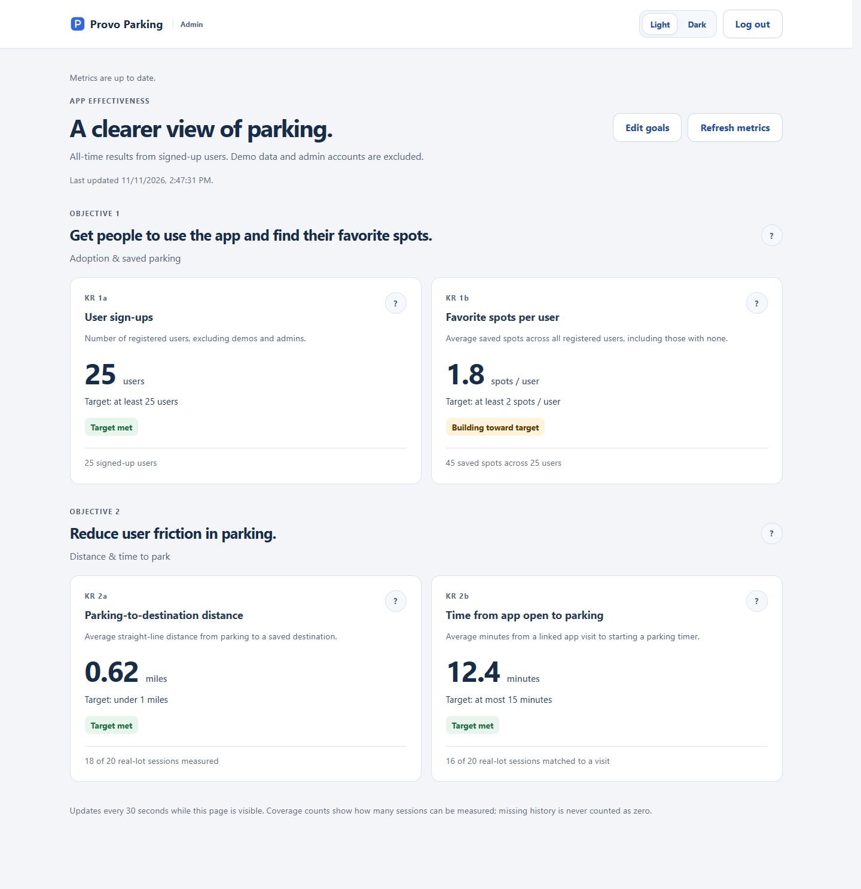
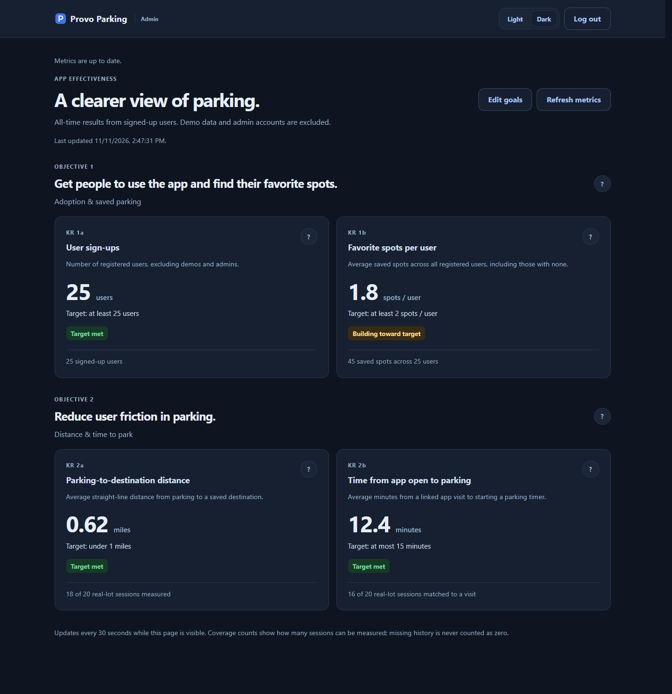
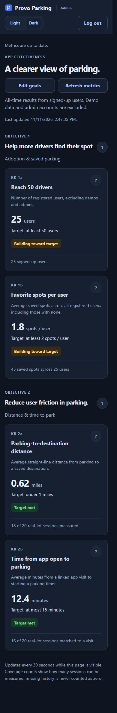

# Admin dashboard and automatic OKR tracking

## Shared goal editing

The dashboard's **Edit goals** action lets authorized admins change both objective titles, all four key-result titles, and their numeric targets. Changes persist in the database and appear for other admins on refresh. The underlying measures, units, all-time reporting window, and comparison directions stay fixed and are shown in the editor. Changing a title does not create a new metric or reset its history.

Apply `supabase/migrations/20261111213837_admin_okr_goals.sql` **after** `20261105040000_admin_okr_tracking.sql`, using the team's migration workflow. It adds one private configuration row and two authenticated RPCs. Defaults match the existing goals; rerunning the migration preserves saved edits. This PR does not apply migrations or deploy to production. If the new RPC is unavailable, the dashboard still displays metrics with a visible default/last-loaded-target notice and disables editing.

Only members of the existing private admin allowlist can load or save goals. Ordinary users and guests cannot call the RPCs, and browser roles have no direct table access. Saves validate titles and target ranges on the server and use a revision check to reject concurrent overwrites. If another admin saves first, cancel the editor, refresh, and review their changes before editing again. Cancel and Escape discard unsaved form changes.

**Light** and **Dark** at the top share the app's saved appearance preference. Question marks show short explanations on hover or keyboard focus; click/tap opens a dialog with the full measurement details and why it matters. Escape dismisses hover explanations. Distances remain straight-line estimates and elapsed parking time remains a proxy based on a linked visit and timer start.

Validation: `npm test`; database assertions in `tests/fixtures/admin-goals-assertions.sql` (run by `tests/admin-goals-db.test.js` with a disposable PostgreSQL URL); local browser checks at 1440px and 390px, both themes, WCAG AA axe checks, save/reload against an isolated PostgreSQL engine, conflict handling, and missing-migration behavior. Screenshots use synthetic metrics and a test admin, not production records.





**Visit tracking reconciled (2026-11-05).** This PR originally created its own `app_visit(user_id, open_token)` table and a second client hook. Production already runs the `visit_metrics` implementation (`app_visit(id, secret_hash, owner_id, opened_at)` plus `visit_metrics_private.visit_link`). The admin migration now reuses that data for KR 2b and no longer creates, alters or grants on `app_visit`; the duplicate `js/data/visits.js` hook was removed. The migration was renamed to `20261105040000_admin_okr_tracking.sql` so file order matches production order. Not yet applied to production.

### Migration order (as applied to production, checked 2026-11-05)

| # | Repo file | Production history |
| --- | --- | --- |
| 1 | `supabase/schema.sql` (+ rule source columns) | `create_provo_parking_schema`, `add_rule_source_columns` |
| 2 | `20261029143325_enable_parking_reference_reads.sql` | applied |
| 3 | `20261029224555_parking_session_persistence.sql` | applied |
| 4 | `20261102040636_account_sign_in.sql` | applied |
| 5 | `20261104155225_verified_byu_lots.sql` | applied |
| 6 | `20261105025053_verified_byu_sections.sql` | applied |
| 7 | `20261105032816_visit_metrics.sql` | applied |
| 8 | **`20261105040000_admin_okr_tracking.sql`** | **not applied: this PR** |

Production version numbers differ from the repo filenames because files were applied through the SQL tool, which stamps its own version. The admin migration refuses to run if step 7 is missing. `tests/helpers/migration-order.js` holds the same order for the database tests.

This PR targets **ParkerMorris11's Org → provo-parking**, project **rikekjksneoymybnehpo**:
<https://supabase.com/dashboard/project/rikekjksneoymybnehpo>.
Do not apply its migration to another project. The authoring agent could not access this project through its connected Supabase accounts; no production migration, account creation or deployment was performed. The PR is intentionally unmerged.

## Rollout checklist for a person or another AI

1. Check out this PR branch. Confirm the database/project ref above and inspect current tables, policies and migration history before writing anything. The connected account must have access to Parker's organization. Never substitute another accessible project.
2. Confirm the existing account-sign-in and verified-lot migrations are present: `app_user.auth_id`, `parking_area.is_sample_data` and the ordinary per-user RLS policies must exist. The original `supabase/schema.sql` contains demo data: **do not replay it on production**.
3. Confirm `visit_metrics` (step 7 above) is in the migration history and `public.app_visit` has `id, secret_hash, owner_id, opened_at`. Then read and apply **only** `supabase/migrations/20261105040000_admin_okr_tracking.sql` through the project's SQL Editor or the Supabase MCP `apply_migration` tool, using the exact file contents. This file creates the destination table and admin allowlist, seeds ten sourced buildings, adds the nullable destination foreign key and protects metrics access. It does not grant any admin accounts. It is transaction-wrapped and repeatable. If using SQL Editor, reconcile the file version with your team's migration-history workflow before subsequent CLI deployments. Do not mark it applied until it succeeds.
4. Provision an admin identity and grant membership as described below. Test both the allowed and denied cases before sharing access.
5. Use the project's existing browser-safe URL and anon/publishable key in local `config.js` to preview this branch. Keep the file ignored. Its shape is in `config.example.js`. Do **not** put a service-role key or admin password in `config.js`, Git, HTML, issue comments or this PR.
6. Click through the acceptance checklist below against the real project. Run Supabase security/performance advisors. Fix new findings before rollout. The new tables have RLS and explicit grants; the cross-user function implementation is in a non-exposed schema.
7. Leave the PR unmerged for review. When the owner authorizes deployment separately, the existing Pages workflow publishes `admin.html` along with `index.html`; it continues to generate `config.js` from the repository secrets. Applying SQL alone does not deploy the UI.

The migration is backward compatible with the existing deployed frontend: older sessions may omit a destination and will be reported as unmeasured for KR 2a. No historical visits or destinations are fabricated/backfilled. New frontend timer starts require a destination. Apply the migration **before** deploying the new frontend, which queries `destination` while loading parking data.

## Username and password, with secure managed authentication

The admin form asks for **Admin username** and **Password**, not an email address. Usernames are case-insensitive, 3–32 characters, start with a letter, and contain letters, numbers, dots, underscores or hyphens.

Supabase Auth manages password hashing, credential verification and its normal sign-in rate limits. Internally, `parking-admin` maps to `parking-admin@admin.provoparking.invalid`. This is an Auth identifier, **not a deliverable mailbox**. The mapping is public and is not an access control; the private database allowlist is authoritative. There is no built-in admin password or client-side bypass. Do not create a shared password for all administrators; provision one identity per person.

### Create the identity

Choose a username and a strong unique password; communicate the password privately. In the target project's **Authentication → Users → Add user → Create new user**, create the mapped Auth identifier, set the password, and mark the identity confirmed. Do not use an invite or email-confirmation flow for the `.invalid` address.

Alternatively, run the following only in a trusted server/operator environment using the [Supabase Admin API](https://supabase.com/docs/reference/javascript/auth-admin-createuser). Read secrets from the environment; never log them. The service-role key is only for this provisioning step and must never reach the browser.

```js
import { createClient } from '@supabase/supabase-js';
const username = process.env.ADMIN_USERNAME.trim().toLowerCase();
if (!/^[a-z][a-z0-9._-]{2,31}$/.test(username)) throw new Error('Invalid username');
const operator = createClient(
  'https://rikekjksneoymybnehpo.supabase.co',
  process.env.SUPABASE_SERVICE_ROLE_KEY,
  { auth: { persistSession: false, autoRefreshToken: false } }
);
const { error } = await operator.auth.admin.createUser({
  email: `${username}@admin.provoparking.invalid`,
  password: process.env.ADMIN_PASSWORD,
  email_confirm: true,
  user_metadata: { display_name: 'Parking administrator' }
});
if (error) throw new Error('Admin identity could not be created; inspect the operator-side error securely.');
```

Use a pinned version of the team's Supabase SDK in that operator environment. If the identity already exists, use its existing Auth UUID; do not create duplicates. The existing account trigger automatically creates its `app_user` profile. The dashboard excludes allowlisted admin identities from the four metrics.

### Grant access using trusted SQL

After creating the identity, run this in the target SQL Editor. Replace only the example username identifier. The statement fails if the identity is missing rather than silently granting nothing.

```sql
DO $$
DECLARE admin_id uuid;
BEGIN
  SELECT id INTO STRICT admin_id FROM auth.users
    WHERE email = 'parking-admin@admin.provoparking.invalid';
  INSERT INTO parking_private.admin_account(auth_id)
    VALUES(admin_id) ON CONFLICT(auth_id) DO NOTHING;
END $$;
```

`parking_private` must **not** be added to the Data API's exposed schemas. Browser users cannot read/write its membership table. Self-editable `user_metadata`, JWT role claims and profile names do not grant admin access. Every metrics query checks the current membership table, so revocation is immediate on the next request; the UI clears displayed metrics if access is denied.

To revoke an admin, use trusted SQL:

```sql
DELETE FROM parking_private.admin_account
WHERE auth_id = (SELECT id FROM auth.users
  WHERE email = 'parking-admin@admin.provoparking.invalid');
```

Reset forgotten admin passwords through the trusted Auth Admin API or Dashboard after verifying the administrator's identity; synthetic identifiers cannot receive reset mail. Restrict who has project-level access to create accounts and edit the allowlist. Preserve the project's existing password policy, rate limits and abuse protections. Admin tokens are held in tab memory, never localStorage; refreshing the admin page requires signing in again. The upper-right Log out clears the dashboard and returns to `index.html#login`, the ordinary sign-in screen.

## Metric definitions and query contract

Authenticated admin request:

```js
const { data, error } = await supabase.rpc('get_admin_okr_metrics');
```

Use the signed-in **admin's** browser-safe client and token. Do not query all personal tables from the frontend and do not use a service key. A regular account receives SQLSTATE `42501`; a visitor has no execute permission. The response contains aggregates only:

| Objective / KR | Response field | Calculation / target |
| --- | --- | --- |
| O1 / KR 1a | `signups` | Count `app_user` rows with an Auth link, excluding allowlisted admins. Target ≥25. |
| O1 / KR 1b | `favorites_average` | Current `favorite_area` row count for those users ÷ all those users, including users with zero favorites. Target ≥2. Removing a favorite reduces the numerator. |
| O2 / KR 2a | `distance_average_miles` | Mean haversine great-circle distance from real `parking_area` lat/long to the session's saved `destination` lat/long, using earth radius 3958.7613 miles. Target **<1**, strictly. Not a walking route. |
| O2 / KR 2b | `parking_average_minutes` | For each real-lot `parking_session` with a `visit_metrics_private.visit_link` row, average `(parking_session.started_at - app_visit.opened_at)` in minutes, where the linked visit's `owner_id` is the session owner. `visit_bind`/`visit_link_account` choose the owner's latest visit opened in the hour before the server-stamped start. Unlinked sessions and guest (client-reported) timers are excluded. Target ≤15. |

Additional response fields: `measured_at` (database timestamp), `favorites_count`, `total_sessions` (real-lot sessions belonging to eligible users), `distance_sessions` and `parking_sessions`. Coverage counts make exclusions visible. No data yields `null` averages and “No data yet”; zero signups is an actual zero. Status comparisons use unrounded values, including the strict one-mile threshold.

The definition is all-time **currently retained** account/session data, not a lifetime event counter. Deleted accounts/rows are no longer counted. Legacy unlinked demo profiles, demo parking lots and active admin identities are excluded. Favorites still count the signed-up user's saved spots, including any historical saved sample spots. The destination table's sourced building/lot center coordinates are approximate; correcting reference coordinates changes the calculated historical distance.

### Automatic collection

- Sign-up: existing Auth trigger inserts `app_user`; no extra client counter.
- Favorite: existing favorite insert/delete updates the live average; no duplicate analytics event.
- Destination: ten buildings are seeded from the GIS layer used by the official [BYU campus map](https://map.byu.edu/). The source feature URLs, retrieval date and bounding-box-center method are saved in `data/byu-destinations.json`. Choose on Find; My car inherits that choice and permits changing it before Start. `parking_session.destination_id` is saved when the main app timer starts.
- Visit: the existing `visit_metrics` tracker (`js/data/visit-tracker.js`). `visit_open` runs when the app first loads in a tab, before sign-in, so sign-in screen time **is** measured; the same visit is reused in that tab for up to an hour. `visit_bind` attaches it to the account on sign-in, and `visit_link_account` links it to the timer after a successful `parking_session` insert. Only a SHA-256 hash of the per-visit secret is stored; browser roles cannot read `app_visit` or `visit_link`. Client clocks cannot set visit/session measurement times. A visit failure never blocks starting a timer; that session is simply unmatched.
- Sessions: the existing main-app `parking_session` timer is measured; the separate P5 local timer / P7 `owned_parking_session` demo pages are outside these OKRs. Their guest visit links (`guest_session_id`) remain visible in `supabase/queries/kr-2b.sql` as client-reported, but are not in the dashboard. Older clients and missing visit/destination history remain visible through coverage counts rather than being assigned guessed values.
- Dashboard: queries the database immediately after admin sign-in and every 30 seconds while visible, plus manual Refresh and returning to the tab. Network/configuration errors are displayed, not converted to zeros. Each question-mark control opens a keyboard-accessible explanation dialog; Escape closes it and returns focus.

## Operator verification

Run these read-only checks in the SQL Editor after applying the migration:

```sql
SELECT building_code, name, latitude, longitude FROM public.destination ORDER BY name;
SELECT table_schema, table_name FROM information_schema.tables
WHERE (table_schema='public' AND table_name IN ('app_visit','destination'))
   OR (table_schema='parking_private' AND table_name='admin_account')
   OR (table_schema='visit_metrics_private' AND table_name='visit_link');
SELECT schemaname, tablename, rowsecurity FROM pg_tables
WHERE tablename IN ('app_visit','visit_link','destination','admin_account');
-- app_visit columns must still be: id, secret_hash, owner_id, opened_at.
SELECT has_function_privilege('anon','public.get_admin_okr_metrics()','EXECUTE') AS anon_allowed,
       has_table_privilege('authenticated','parking_private.admin_account','INSERT') AS self_promotion_allowed;
-- Both permission results must be false.
```

To inspect the exact aggregate logic without granting broader access, read `parking_private.read_okr_metrics()` in the migration. To test it as an actual admin in SQL Editor, use a transaction and a real allowlisted UUID:

```sql
BEGIN;
SET LOCAL ROLE authenticated;
SELECT set_config('request.jwt.claims', '{"sub":"REPLACE-WITH-REAL-ADMIN-AUTH-UUID"}', true);
SELECT public.get_admin_okr_metrics();
ROLLBACK;
```

Never weaken RLS to make the dashboard work. Investigate a failed `42501` by checking the exact Auth UUID and the allowlist with trusted SQL. Do not assign privileges based on a client-supplied username or metadata.

### End-to-end acceptance against the real project

1. Open the regular sign-in page and follow Admin sign in. An ordinary account or invalid password must never reveal metrics.
2. Sign in with the provisioned username/password. Check that four cards appear under their respective objectives and that all four question-mark explanations open, close with Escape, and restore focus.
3. In a separate normal-user session, create an account and save two spots. Refresh the dashboard: signups increase by one; average favorites is recalculated over **all** signed-up users.
4. Open the app in a fresh tab, sign in, choose a destination on Find, start a timer on My car, and inspect the user's own saved session for `destination_id`. In trusted SQL, verify a `visit_metrics_private.visit_link` row now points at that session and a visit owned by that user. Refresh the dashboard: coverage increases and both applicable averages change.
5. Log out using the upper-right admin button: the ordinary Welcome back screen must appear. Use Back and Refresh: dashboard metrics must require authorization again.
6. Revoke membership in SQL while the admin page is open, then Refresh: the dashboard must clear. Re-grant only if appropriate.
7. Test phone and desktop widths, keyboard-only navigation and a screen reader. Run Lighthouse Accessibility on sign-in, dashboard and explanation states against the actual deployed configuration. Automated scores do not replace manual accessibility checks.

## Tests and rollback

Local verification used a database-backed browser fixture with the actual app code and an isolated PostgreSQL engine. Lighthouse Accessibility **snapshot** audits scored **100/100** for admin username sign-in, the signed-in dashboard and an open explanation dialog at both 390px and 1280px. Axe found no violations for the dashboard and all four dialogs at both widths. These measurements cover the preview fixture, not a production audit; rerun them after connecting and deploying Parker's project. The fixture exercised Find → destination selection → app_visit → parking_session → admin aggregates, plus unauthorized access, revocation, keyboard focus and logout. Screenshots use synthetic accounts, not production data.

`npm run check` includes UI/data-helper tests. With `P7_TEST_DATABASE_URL=postgresql://postgres@127.0.0.1:<port>/provo_parking_p7_test` set, the database tests apply the migrations in the production order above. `tests/visit-admin-combined-db.test.js` seeds pre-existing users, favorites, a session and linked/unlinked visits through the real RPCs, applies the admin migration twice, checks those rows and the `app_visit` columns/grants are unchanged, then drives `visit_open`/`visit_bind`/`visit_link_account` and checks KR 2b, KR 2a, coverage counts, exclusions (sample lot, admin, unmatched, guest) and access controls. `tests/admin-okr-db.test.js` runs the migration twice and checks aggregate math, latest-visit matching, empty state, owner-only writes, forged metadata, timestamp protection, denied access and role revocation against the team's disposable local PostgreSQL database (`P7_TEST_DATABASE_URL`). It refuses remote targets. `tests/fixtures/admin-okr-*.sql` are destructive **local test fixtures only**, never production setup instructions.

For rollback, revert the frontend deployment first. The migration is additive, so keep destination/visit history; do not drop the tables or column. Revoke allowlist membership to disable dashboard access immediately. Existing deployed clients can continue to start timers without a destination; those rows remain unmeasured for KR 2a.
