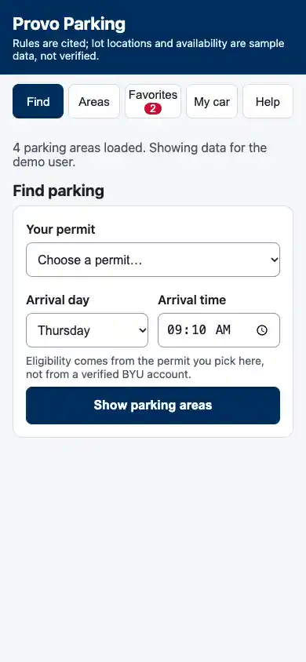
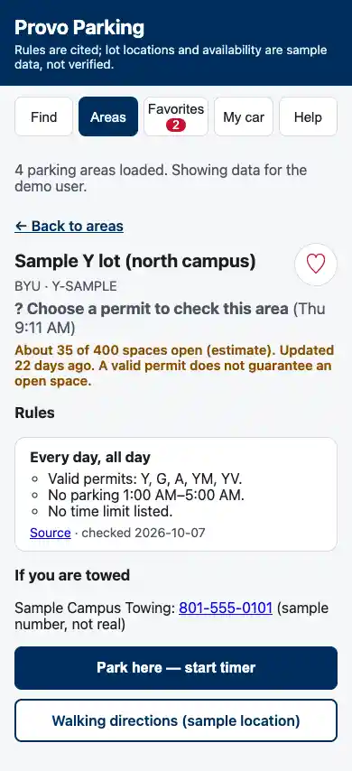
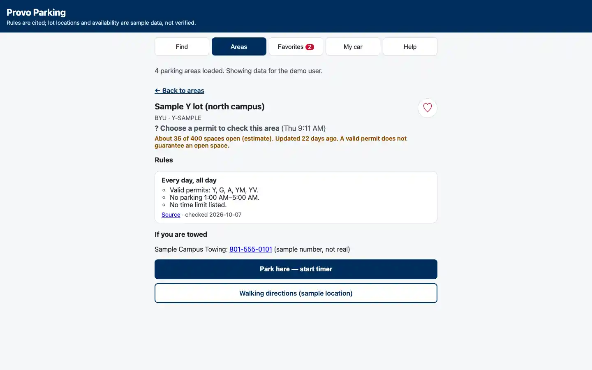

# P2: Connect the live parking data

Trello: https://trello.com/c/TOVP6Xvu

## Reproduced on October 29, 2026

The live GitHub Pages app connects to the existing `provo-parking` Supabase project and loads four parking areas. However, Find has only the "Choose a permit" placeholder. The database contains 11 permits, 16 parking rules, and two tow-company reference rows, but these three tables have RLS enabled without SELECT policies for the browser's `anon` role.

The browser-role assertion in `supabase/tests-reference-reads.sql` failed before the fix with `Browser role cannot read permits`. This is a visibility problem, not missing seed data or a missing browser key. Do not rerun schema.sql or duplicate the seed rows.

## Approved fix — applied October 29, 2026

`supabase/migrations/20261029143325_enable_parking_reference_reads.sql` adds SELECT policies for `anon` on `permit`, `parking_rule`, and `tow_company`. RLS remains enabled. It adds no policies for profiles, user permit selections, or parking sessions. Visitor write privileges on these three reference tables are explicitly revoked.

The user explicitly approved public reference-data reads after reviewing the tradeoff. The migration was then successfully applied to the live `provo-parking` project through Supabase's migration tool.

This migration is not a general security audit or the Sprint 2 sign-in implementation.

Verified after application: the rollback-only browser-role assertions pass, including denied visitor write privileges and hidden profiles, user permits, and sessions. The live picker lists all 11 permit types. With Y at 8:00 a.m., Y/U lots are allowed and the residential permit street is not covered. At 3:00 a.m., Y/U lots display the 1–5 a.m. restriction. Switching to PP at 8:00 a.m. reverses the permit results. The lot detail page now displays permit names, restriction hours, a source link, and the checked date. Screenshots are captured from the live GitHub Pages site, not a database stand-in.

## Accessibility and responsive evidence — October 29, 2026

Google Lighthouse 13.6.0 audited the live site with a fresh browser session at each route. All six runs completed without run warnings:

| Screen | Phone 390 × 844 | Laptop 1440 × 900 |
|---|---:|---:|
| Find (`#find`) | 100/100 | 100/100 |
| Areas (`#areas`) | 100/100 | 100/100 |
| Lot rules (`#area/1`) | 100/100 | 100/100 |

These scores cover automated accessibility checks, not a complete screen-reader audit. Lighthouse screenshots were visually inspected: controls, cards, and rule text wrap within the phone layout, and the laptop view stays readable. Fresh-session Areas screenshots correctly ask for a permit; the selected-permit interactions were separately checked in the normal browser at 1280 × 720. Enter activates Show parking areas and Rules & details, and navigation focuses the destination heading. The normal browser had no horizontal overflow at that width.

The in-app browser ignored its requested phone-width override, and the Chrome browser connector was unavailable by policy. Therefore phone layout evidence comes from Lighthouse's emulated viewport; interactive clicking was not manually retested at phone width. Human review on a real phone remains useful before acceptance.

Repeat an audit with an installed Chrome and Node using `npx lighthouse https://parkermorris11.github.io/ProvoParking/#find --only-categories=accessibility --output=html --screenEmulation.width=390 --screenEmulation.height=844 --screenEmulation.deviceScaleFactor=1 --chrome-flags=--headless`. Add `--preset=desktop` and use 1440 × 900 for laptop, and change the hash route for the other screens.

Local `npm run check` passes all 10 baseline tests. GitHub Checks passed for commit `ad588d0` (run 40897967693). P5's eligibility changes and extra tests were merged separately in [PR #4](https://github.com/ParkerMorris11/ProvoParking/pull/4); main now passes 17 tests.

## Repeat the verification

1. Run `supabase/tests-reference-reads.sql`. It checks the actual browser role can read all three reference tables while profiles, user permit selections, and parking sessions remain hidden. It runs in a transaction and writes no rows.
2. Reload https://parkermorris11.github.io/ProvoParking/ and check Find now lists permit options.
3. Select Y and an 8:00 a.m. arrival, then Show parking areas. Confirm the Y/U sample lots have readable eligibility results and source-backed rules in Rules & details.
4. Change the arrival to 3:00 a.m. and confirm the campus overnight restriction appears. Change the permit and confirm results refresh.
5. Refresh and check the selected permit still appears. Check at phone and laptop widths and save screenshots.

Lot locations, availability, and tow details remain sample data. Liam's L1 card owns verified lot data. P5's eligibility fixes were merged in PR #4. Do not mark P2 Done until the live verification and the course Definition of Done are satisfied.
